# `review` — Multi-Lane Code Review Skill

[](./LICENSE)
[-3776AB.svg)](./scripts)
[](https://www.asd-ste100.org/)

A **framework-agnostic, codebase-aware, multi-lane code review skill** for AI coding agents, driven through a single `/review` entrypoint and written in **ASD-STE100 Simplified Technical English (STE)**.

`review` plans each review from the diff shape and intent sources, delegates issue discovery to parallel subagent lanes with strict non-overlapping ownership, verifies high-severity findings using independent blind verifiers, filters noise through 10 deterministic quality gates (`G0`–`G9`), tracks findings across re-reviews (`carry`), and delivers a single, high-signal review report.

---

## Table of Contents

1. [Key Capabilities](#key-capabilities)
2. [Architecture & 5-Phase Workflow](#architecture--5-phase-workflow)
3. [Prerequisites & Installation](#prerequisites--installation)
4. [Usage & Single `/review` Entrypoint](#usage--single-review-entrypoint)
5. [Effort Profiles & The Five Core Invariants](#effort-profiles--the-five-core-invariants)
6. [Review Lanes & Non-Overlapping Ownership](#review-lanes--non-overlapping-ownership)
7. [Framework-Agnostic Intent Discovery](#framework-agnostic-intent-discovery)
8. [Deterministic Quality Gates (`G0`–`G9`) & Scripts](#deterministic-quality-gates-g0g9--scripts)
9. [Stateful Re-Review & Carry System (`G9`)](#stateful-re-review--carry-system-g9)
10. [Reviewer Persona, House Rules & Learned Memory](#reviewer-persona-house-rules--learned-memory)
11. [ASD-STE100 Simplified Technical English](#asd-ste100-simplified-technical-english)
12. [Security, Safety & Privacy Guarantees](#security-safety--privacy-guarantees)
13. [Repository Structure](#repository-structure)
14. [Running Tests](#running-tests)
15. [License](#license)

---

## Key Capabilities

- **Single `/review` Entrypoint:** Reviews a GitHub PR (by URL, `<owner>/<repo>#<N>`, or `#<N>`), automatically infers the open PR for the current branch via `gh pr view`, falls back to **local branch diff mode** against the base branch when no PR exists, or configures reviewer persona and preferences interactively.
- **Framework-Agnostic Intent Chain:** Automatically extracts promises, requirements, and acceptance criteria (`ACRow`) from PR descriptions, commit messages, linked tracker tickets/issues (GitHub, Jira, Linear, YouTrack, MCP resources), and planned specification files across any spec-driven framework (`.kiro/specs/`, `.specify/`, `openspec/`, `_bmad/`, `.cursor/plans/`, `.claude/plans/`, `.gemini/`, `docs/specs/`, `PLAN.md`, `PRD.md`, etc.).
- **Parallel Multi-Lane Subagents with Zero Overlap:** Selects up to 6 concurrent specialist lanes (`adherence`, `code-quality`, `security`, `performance`, `compatibility`, `robustness`, `conventions`) based on diff-shape signals and assigns strict concern ownership so lanes never duplicate work.
- **Blind Independent Verification:** Every `CRITICAL` and `HIGH` finding—plus every `Missing` or `Contradicted` acceptance criterion—is re-checked at `head_sha` by an independent verifier subagent that receives only the claim, location, and trigger (never the lane's reasoning).
- **Deterministic Python Quality Gates (Stdlib-Only):** Uses zero-dependency Python scripts in [`scripts/`](./scripts) to map diff lines (`diff_map.py`), enforce schema/diff/trigger/confidence gates (`schema_lint.py`), reconcile carried findings across commits (`carry_findings.py`), compute mechanical verdicts (`breaker.py`), lint Simplified Technical English (`ste_lint.py`), and measure per-lane precision (`precision.py`).
- **Stateful Re-Review & Delta Carry:** Automatically detects prior reviews of the same PR, assigns stable finding IDs (`B1`, `D1`, `S1`, …), reviews only the commit delta (`<last_sha>..<head_sha>`) when history is linear, preserves user declines, and requires code evidence at `head_sha` to close open `CRITICAL`/`HIGH` findings or challenge prior declines.
- **Configurable Persona & Memory Acquisition:** Adapts emphasis, comment structure, inline budgets, tone (`direct`, `constructive`, `mentor`, `strict`, `concise`), objective house rules (§8), and learned preferences (§9) via [`reference/persona.md`](./reference/persona.md) without ever compromising the safety floor or STE grammar.

---

## Architecture & 5-Phase Workflow

```mermaid
flowchart TD
    Entry["/review $ARGUMENTS"] --> ModeSwitch{"Mode Switch"}
    ModeSwitch -->|"Persona / Preference Setup"| ConfigMode["Interactive Persona Configuration<br/>(reference/output/persona-pass.md)<br/>Updates reference/persona.md"]
    ModeSwitch -->|"Code Review"| P0["Phase 0: Plan (Inline)"]

    subgraph Phase0 ["Phase 0: Plan (Inline, Built Once)"]
        P0 --> P01["0.1 Resolve Target & Effort<br/>(GitHub PR | Current Branch PR | Local Branch Diff)"]
        P01 --> P02["0.2 Check Persona & Memory<br/>(reference/persona.md frontmatter)"]
        P02 --> P03["0.3 Build Bundle & Run G0 / G0b<br/>(pr.json, diff.patch, head/, base/, diff-map.json,<br/>existing-comments.json, signals.txt, rules-changed.txt)"]
        P03 --> P03Carry["0.3b Carry & Delta Check<br/>(scripts/carry_findings.py prepare)"]
        P03Carry --> P04["0.4 Build Intent Chain<br/>(Specs, Plans, Tickets, PR Claims -> intent.md)"]
        P04 --> P05["0.5 Select Lanes & Ownership<br/>(reference/lanes/selection.md)"]
        P05 --> P06["0.6 Print Review Plan in STE"]
    end

    subgraph Phase1 ["Phase 1: Fan Out (Concurrent Subagents)"]
        P06 --> Lanes["Launch Selected Lanes in One Message<br/>(adherence | code-quality | security | performance |<br/>compatibility | robustness | conventions | critical-risk | skim)"]
    end

    subgraph Phase2 ["Phase 2: Merge, Gate, Verify & Breaker"]
        Lanes --> G1["2.1 Gate G1: Schema Validation<br/>(scripts/schema_lint.py)"]
        G1 --> G26["2.2 Gates G2-G6, Calibration & Dedupe<br/>(In-Diff, Trigger, Confidence, Already Raised, Linter)"]
        G26 --> Verify["2.3 Blind Verification<br/>(lanes/verifier.md on CRITICAL/HIGH & Missing/Contradicted ACs)"]
        Verify --> G9["2.3b Gate G9: Reconcile Carry State<br/>(scripts/carry_findings.py reconcile)"]
        G9 --> Breaker["2.4-2.5 Deterministic Breaker & Verdict<br/>(scripts/breaker.py -> verdict, phrase, event, band)"]
        Breaker --> Pareto["2.6 Pareto Cut (medium effort only)"]
    end

    subgraph Phase3 ["Phase 3: Persona Pass & STE"]
        Pareto --> PersonaPass["Re-rank by Emphasis, Fold Minor/Suppressed,<br/>Apply Tone, Gate G7 (Inline Budget)"]
        PersonaPass --> G8["Gate G8: STE Self-Check & Lint<br/>(scripts/ste_lint.py)"]
    end

    subgraph Phase4 ["Phase 4: Deliver, Post & Learn"]
        G8 --> Report["4.1 Print Chat Report & Save Durable Artifacts<br/>(~/.claude/review/reviews/&lt;owner&gt;-&lt;repo&gt;-&lt;N&gt;-&lt;sha7&gt;/)"]
        Report --> PostPrompt["4.2 Interactive Action Selection, Feedback Log<br/>(~/.claude/review/feedback.jsonl) & Preference Memory"]
        PostPrompt --> PostGH["4.3 Optional GitHub Review Posting<br/>(SHA Check, Diff-Line Map, G8 Check, Explicit Confirmation)"]
    end
```



### Phase Breakdown

| Phase | Owner | Responsibility | Key References & Scripts |
| :--- | :--- | :--- | :--- |
| **Phase 0: Plan** | Lead (inline) | Resolves target and effort level, checks persona status, builds the immutable review bundle (`bundle_dir`) once, detects prior reviews for carry/delta mode, discovers the intent chain (`intent.md`), selects lanes, and prints the STE review plan. | [`bundle.md`](./reference/bundle.md), [`intent.md`](./reference/intent.md), [`effort/levels.md`](./reference/effort/levels.md), [`lanes/selection.md`](./reference/lanes/selection.md), [`diff_map.py`](./scripts/diff_map.py), [`carry_findings.py`](./scripts/carry_findings.py) |
| **Phase 1: Fan Out** | Subagent lanes | Runs all selected lanes concurrently in a single message. Every lane reads the shared bundle without re-fetching the PR, stays within its assigned `FOCUS` and `OWNERSHIP`, and returns structured YAML findings (`schema/finding.md`). | [`lanes/prompt.md`](./reference/lanes/prompt.md), [`lanes/lane-rules.md`](./reference/lanes/lane-rules.md), [`schema/finding.md`](./reference/schema/finding.md), [`lanes/*.md`](./reference/lanes) |
| **Phase 2: Merge & Verify** | Lead + Verifiers | Validates lane outputs (`G1`), applies deterministic gates (`G2`–`G6`), recalibrates severities, deduplicates findings across lanes, dispatches blind verifier subagents for `CRITICAL`/`HIGH` and broken ACs, reconciles carried state (`G9`), and runs `breaker.py` to compute the authoritative verdict and quality-gate band. | [`gates.md`](./reference/gates.md), [`lanes/verifier.md`](./reference/lanes/verifier.md), [`output/verdict.md`](./reference/output/verdict.md), [`schema_lint.py`](./scripts/schema_lint.py), [`carry_findings.py`](./scripts/carry_findings.py), [`breaker.py`](./scripts/breaker.py) |
| **Phase 3: Persona Pass** | Lead | Re-ranks findings according to `persona.md` emphasis and learned preferences, folds minor or suppressed items, formats comments in the configured `voice.tone`, enforces posted inline comment caps (`G7`), rewrites all human-read text in ASD-STE100, and verifies compliance with `ste_lint.py` (`G8`). | [`output/persona-pass.md`](./reference/output/persona-pass.md), [`persona.md`](./reference/persona.md), [`output/ste.md`](./reference/output/ste.md), [`output/ste-examples.md`](./reference/output/ste-examples.md), [`ste_lint.py`](./scripts/ste_lint.py) |
| **Phase 4: Deliver & Post** | Lead | Prints the report and AC matrix to chat, archives durable artifacts to `~/.claude/review/reviews/`, logs user keep/drop decisions to `~/.claude/review/feedback.jsonl`, saves generalizable preferences to `persona.md` (when `memory` is `ask` or `enabled`), and posts to GitHub only after verifying `head_sha` has not moved and receiving explicit user confirmation of the exact payload. | [`output/report.md`](./reference/output/report.md), [`output/posting.md`](./reference/output/posting.md), [`precision.py`](./scripts/precision.py) |

---

## Prerequisites & Installation

### Prerequisites

1. **Git** (`git`): Used to inspect local clones, commit snapshots (`git show <head_sha>:<path>`), merge bases, and local branch diffs.
2. **Python 3** (`python3`, 3.8+): Used to execute the deterministic gate, carry, breaker, and linter scripts in [`scripts/`](./scripts). **Uses the Python standard library only**—no `pip install` or virtual environment is required.
3. **GitHub CLI** (`gh`): Required when reviewing GitHub PRs or issues (`gh auth login`). Not required when running in local branch diff mode.

### Installation

Clone this repository into your agent's skill directory:

#### Claude Code
```bash
# User-level skill (available across all repositories)
git clone https://github.com/berkkarahan/review.git ~/.claude/skills/review

# Or workspace-level skill (available in a single repository)
git clone https://github.com/berkkarahan/review.git .claude/skills/review
```

#### Google Antigravity / Gemini CLI
```bash
# User-level skill
git clone https://github.com/berkkarahan/review.git ~/.gemini/skills/review

# Or workspace-level skill
git clone https://github.com/berkkarahan/review.git .agent/skills/review
```

---

## Usage & Single `/review` Entrypoint

`/review` is the **single entrypoint** for all operations. Targets, actions, and flags are resolved from `$ARGUMENTS`, natural language instructions, workspace git context, and prior review state.

### Common Invocations

```text
# 1. Review a GitHub PR by URL, owner/repo#N, or #N
/review https://github.com/owner/repo/pull/42
/review owner/repo#42
/review #42

# 2. Review the current branch (infers open PR via `gh pr view`, or falls back to local branch diff vs base branch)
/review

# 3. Review with an explicit effort level or natural language instruction
/review #42 --effort=high
/review #42 do a quick skim review

# 4. Re-review only new commits since the last review, or force a fresh review ignoring carried state
/review #42 --since-last
/review #42 --fresh

# 5. Point explicitly to a planned spec / design document
/review #42 --spec=docs/specs/auth-migration.md

# 6. Override lanes or run inline
/review #42 --lanes=adherence,security,conventions
/review #42 --no-inherit
/review #42 --inline

# 7. Configure reviewer persona, tone, house rules, or memory interactively
/review configure my persona to use constructive tone and emphasize security and backward-compatibility
```

### Options & Flags Reference

All options can be passed as explicit flags or stated in natural language:

| Option / Flag | Values / Syntax | Default | Behavior |
| :--- | :--- | :--- | :--- |
| `--effort` | `high \| medium \| low \| skim \| auto` | `auto` | Controls bundle depth, lane count, verifier subagents, Pareto cuts, and report length. See [Effort Profiles](#effort-profiles--the-five-core-invariants). |
| `--since-last` | flag | auto-detected | Reviews the commit delta (`<last_sha>..<head_sha>`) when an earlier review exists and `last_sha` is an ancestor of `head_sha`. Automatically triggered when new commits are pushed. |
| `--fresh` | flag | `false` | Ignores any earlier `findings.json` in `~/.claude/review/reviews/` and runs a clean full review without carry state. |
| `--spec` | `<path-or-url>` | auto-discovered | Explicitly adds a planned document, spec, RFC, PRD, or URL to the Intent Chain (`Phase 0.4`). Ignored at `skim`. |
| `--lanes` | `lane1,lane2,...` | signal-driven | Runs the exact comma-separated lane list at `high` and `medium` (warns if `adherence` is omitted). Narrows the `critical-risk` focus list at `low`. Ignored at `skim`. |
| `--no-inherit` | flag | `false` | Runs only `adherence` and `conventions` (skips checklist-based lanes). At `low`, removes security/performance items from `critical-risk`. Ignored at `skim`. |
| `--inline` | flag | auto (`small_pr`) | Forces small-PR mode at `high`/`medium` (lead runs `adherence` inline while at most 2 other lanes run in parallel). Ignored at `skim`. |
| `--post` | flag | interactive prompt | Proceeds directly to the Phase 4.3 GitHub review payload builder and confirmation flow after generating the report. |

**Option Precedence:** `--effort` → `--lanes` → `--no-inherit` → `--inline` / small-PR mode → `--spec` → `--post`.

---

## Effort Profiles & The Five Core Invariants

### The Five Core Invariants

Regardless of whether a review runs at `high`, `medium`, `low`, or `skim`, **five rules always hold** ([`reference/effort/levels.md`](./reference/effort/levels.md)):

1. **Safety Floor:** No lane cap, Pareto cut, budget gate (`G7`), or persona preference may drop or downgrade a verified `CRITICAL` or `HIGH` finding.
2. **ASD-STE100 Compliance:** Every human-read text (the Phase 0.6 plan, the chat report, the posted review body, inline comments, and author questions) is written in ASD-STE100 Simplified Technical English.
3. **Mandatory Gates:** `G0` (PR state), `G2`–`G4` (in-diff, concrete trigger, confidence—by script at `high`/`medium` and inline at `low`/`skim`), and `G8` (`ste_lint.py`) execute at every level.
4. **Verdict Before Cuts:** The verdict, GitHub review event, and quality-gate band are computed on the full merged and verified finding set *before* any Pareto cut (`medium`) or inline budget folding (`G7`). Cuts only affect display volume, never the verdict.
5. **Deterministic Breaker:** [`scripts/breaker.py`](./scripts/breaker.py) runs at all four levels and is the sole authority for the verdict, phrase, GitHub event, and quality-gate band.

### Automatic Effort Resolution (`--effort=auto`)

When `--effort` is omitted or set to `auto`, Phase 0.3 selects the profile using the first matching condition:

| Order | Condition | Resolved Effort |
| :---: | :--- | :--- |
| **1** | Bot author (`Dependabot`, `Renovate`, etc.), lockfile/manifest-only diff, or matches the `skim` size profile (< 100 changed lines across ≤ 4 files with no spec/high-risk signals) | `skim` |
| **2** | Fewer than 400 core changed lines, no planned spec/doc, and none of the `auth`, `data`, or `contract` signals | `low` |
| **3** | Fewer than 1,500 core changed lines and at most 2 planned specs/docs | `medium` |
| **4** | Otherwise | `high` |

### Effort Profile Comparison

| Dimension | `high` (Baseline) | `medium` | `low` | `skim` |
| :--- | :--- | :--- | :--- | :--- |
| **Bundle Context** | Full (`head/` copies + up to 20 context files / 3k LOC + `base/` rules) | Full (`head/` copies + up to 10 context files / 1.5k LOC + `base/` rules) | Reduced diff only; no `head/` copy, no context files | `diff.skim.patch` + `lock.patch` only; no `head/`, no `signals.txt` |
| **Intent Pack** | Full (specs, plans, tickets, issues, PR claims) | Full | Compact (ACs/promises, must-not-change boundaries, PR claims, conflicts) | PR title, description, and commit headlines only (no specs/tickets) |
| **Phase 1 Lanes** | Up to **6** parallel lanes | Up to **3** parallel lanes (wider folding into `conventions`) | Lead inline if reduced diff < 400 lines; else **1** `critical-risk` lane | Exactly **1** `skim` subagent |
| **Severities Reported** | All (`CRITICAL`, `HIGH`, `MEDIUM`, `LOW`, `QUESTION`) | All (Pareto-ordered; ≤ 5 non-blocking per lane) | `CRITICAL` and `HIGH` only | `CRITICAL`, `HIGH`, and ≤ 3 `QUESTION`s |
| **AC Matrix** | All rows shown/archived | All evaluated; only non-`Met` rows returned | Only `Missing` and `Contradicted` rows (no test column) | None |
| **Blind Verifiers** | Up to **6** verifier subagents + inline MEDIUM check | Up to **2** verifier subagents (`CRITICAL`/`HIGH` only) + inline MEDIUM check | Lead verifies inline (no subagents) | Lead verifies inline (no subagents) |
| **Quality Gate Band** | Full (`PASS` / `CONCERNS` / `FAIL`) | Computed on active lanes; marked `(partial)` if folded | `n/a` | `n/a` |
| **Persona Pass** | Full (re-rank, fold, tone, `G7`, STE, `G8`) | Full on Pareto set | STE rewrite + `G8` only | STE rewrite + `G8` only |
| **`APPROVE` Allowed?** | Yes | Yes | **Never** (event is always `COMMENT`) | Only when in-profile, CI is `passing`, and `!author_is_me` |

---

## Review Lanes & Non-Overlapping Ownership

Phase 0.3 scans changed paths and diff content to emit diff-shape signals into `<bundle_dir>/signals.txt`:
- `auth`: authentication, permissions, guards, tokens, JWT, OAuth, sessions, roles, ACLs
- `input`: controllers, request parsing, serializers, DTOs, uploads, webhooks, raw SQL, deserialization
- `deps`: package manifests, lockfiles, `Dockerfile` base images, CI workflow actions
- `data`: schema migrations, models/entities, `ALTER`, bulk updates/deletes, backfills
- `contract`: public routes, API handlers, OpenAPI/GraphQL/Protobuf/Avro schemas, queue events, feature flags
- `perf`: queries in loops, N+1 patterns, pagination, background jobs, caching, heavy UI renders
- `async`: `async`/`await`, threads, goroutines, locks, workers, transactions, retries
- `ui`: `.tsx`/`.jsx`/`.vue`/`.svelte`, templates, CSS, mobile UI

### Lane Selection & Ownership Table

Each concern has **one owner lane** ([`reference/lanes/selection.md`](./reference/lanes/selection.md)). When an owner lane runs, other lanes are explicitly instructed to skip its territory so findings are never duplicated:

| Lane | Stable ID Prefix | Trigger Condition | Method File | Exclusive Ownership (Skipped by Other Lanes When Active) |
| :--- | :---: | :--- | :--- | :--- |
| **`adherence`** | `B` | **Always** (1 lane per planned doc/spec, max 3 at `high`, 1 at `medium`) | [`lanes/adherence.md`](./reference/lanes/adherence.md) | Intent, promises (`P1..Pn`), acceptance criteria (`AC1..ACn`), scope boundaries, and undocumented behavior changes. |
| **`code-quality`** | `D` | **Always** (unless `--no-inherit`) | [`lanes/checklist-code-quality.md`](./reference/lanes/checklist-code-quality.md) | Logic errors, edge cases, error handling, test adequacy, and maintainability (defers security/perf/naming when those owner lanes run). |
| **`conventions`** | `V` | **Always** | [`lanes/conventions.md`](./reference/lanes/conventions.md) | Naming, typing, reuse, codebase structure, repo instruction files (`CLAUDE.md`, `AGENTS.md`, `GEMINI.md`, `.cursor/rules/*`, etc.), `persona.md` §8 house rules, and §9 learned preferences. |
| **`security`** | `S` | `auth`, `input`, or `deps` signal (or in `persona.md` `emphasis`) | [`lanes/checklist-security.md`](./reference/lanes/checklist-security.md) | Authn/authz, injection, secrets, multi-tenancy isolation, dependency risk, and STRIDE threats. |
| **`performance`** | `P` | `perf` or `data` signal (or in `persona.md` `emphasis`) | [`lanes/checklist-performance.md`](./reference/lanes/checklist-performance.md) | Query count, N+1 queries, missing pagination, unbounded memory, and synchronous HTTP/I/O inside loops (static analysis only). |
| **`compatibility`** | `A` | `contract` or `data` signal (or in `persona.md` `emphasis`) | [`lanes/checklist-compatibility.md`](./reference/lanes/checklist-compatibility.md) | Public API/schema contract stability, breaking consumer changes, and zero-downtime migration rollout safety. |
| **`robustness`** | `R` | `async` signal (or in `persona.md` `emphasis`) | [`lanes/checklist-robustness.md`](./reference/lanes/checklist-robustness.md) | Concurrency, race conditions, transaction boundaries, idempotency, and side-effect ordering. |
| **`critical-risk`** | `X` | `low` effort profile | [`lanes/critical-risk.md`](./reference/lanes/critical-risk.md) | Consolidated high-severity pass focusing strictly on `CRITICAL` and `HIGH` bugs, security flaws, data loss, and broken core promises. |
| **`skim`** | `K` | `skim` effort profile | [`effort/skim-agent.md`](./reference/effort/skim-agent.md) | Fast single-subagent pass on small/trivial PRs checking for `CRITICAL`/`HIGH` defects and up to 3 `QUESTION`s. |

---

## Framework-Agnostic Intent Discovery

Unlike code reviewers that only inspect the diff in isolation, Phase 0.4 ([`reference/intent.md`](./reference/intent.md)) constructs `<bundle_dir>/intent.md` as the single source of truth for **what the change promises to accomplish**:

1. **Explicitly Named or Linked Specifications:** Reads `--spec` paths/URLs, repo pointers, GitHub issues/PRs, and external tracker tickets or docs reachable via MCP tools (Jira, Linear, YouTrack, Notion, Confluence, etc.). Unreadable external links are recorded transparently under `Gaps`—never guessed.
2. **Repository & Branch Planned Documents:** Automatically discovers spec and plan artifacts across any spec-driven development framework or agentic planning workflow:
   - **Standard spec folders:** `docs/specs/**`, `docs/design/**`, `docs/rfcs/**`, `docs/adr/**`, `docs/prd/**`, `docs/stories/**`, `specs/**`, `plans/**`, `tasks/**`
   - **Agentic & Spec-Driven Frameworks:** `.kiro/specs/**` (`requirements.md`, `design.md`, `tasks.md`), `.specify/**` (`spec.md`, `plan.md`, `tasks.md`), `openspec/**` (`proposal.md`, `spec.md`, `tasks.md`), `_bmad/**`, `.cursor/plans/**`, `.claude/plans/**`, `.gemini/**`
   - **Standalone files:** `*.spec.md`, `*.plan.md`, `plan.md`, `implementation_plan.md`, `IMPLEMENTATION_PLAN.md`, `PLAN.md`, `design.md`, `requirements.md`, `tasks.md`, `prd.md`, `PRD.md`
3. **Issues/Tickets as Specs:** Extracts checklists, user stories, and "Definition of Done" criteria from linked issues.
4. **PR Description & Commit Promises (`P1..Pn`):** Extracts every concrete behavioral claim or non-change guarantee ("refactors X with no behavior change") from the PR body and commit headlines.

**Intent Precedence (Highest to Lowest):**
1. Explicit acceptance criteria, verification criteria, and "must not change" boundaries in the planned spec/document
2. Planned requirements, tasks, and design specifications
3. Linked tracker ticket or GitHub issue
4. PR description and commit messages

When intent sources conflict, the conflict is recorded in `intent.md` under `Conflicts` and raised as a `QUESTION` for the author rather than guessed.

---

## Deterministic Quality Gates (`G0`–`G9`) & Scripts

Gates keep false positives and noise out of the review report ([`reference/gates.md`](./reference/gates.md)). Wherever a Python script is designated, the lead agent **must** run the script rather than judging by eye.

### Gate Summary Table

| Gate | Phase | Pass Condition | Action on Failure | Enforcement |
| :---: | :---: | :--- | :--- | :--- |
| **`G0`** | `0.3` | GitHub PR `state` is `OPEN`. | Stop immediately and report `"PR is closed or merged."` | `pr.json` |
| **`G0b`** | `0.3` | PR is not a draft, bot-authored, or lockfile-only. | Note draft status in `Context`; switch bot or lockfile-only PRs to `skim` unless `--effort` was explicitly set. | `pr.json`, `files.txt` |
| **`G1`** | `2.1` | Required finding schema fields exist, enums are valid, title ≤ 40 chars, `CRITICAL` has `code_example`. | `retry_lane`: re-request failing findings once; after a second failure mark the lane `NOT ASSESSED`. | [`scripts/schema_lint.py`](./scripts/schema_lint.py) |
| **`G2`** | `2.2` | Finding `location` (or at least one site in `locations`) sits on an added right-side line of `diff.patch`. | `move_preexisting`: move to chat-only `"Pre-existing, not introduced by this PR"`. Never post inline. | [`scripts/diff_map.py`](./scripts/diff_map.py) + [`scripts/schema_lint.py`](./scripts/schema_lint.py) |
| **`G3`** | `2.2` | `CRITICAL` and `HIGH` findings specify a concrete `trigger` (input/state + wrong result). | `downgrade`: cap severity at `MEDIUM`, or convert to `QUESTION` if the cause is unknown. | [`scripts/schema_lint.py`](./scripts/schema_lint.py) |
| **`G4`** | `2.2` | No `MEDIUM` or `LOW` finding has `LOW` confidence. | `drop`: remove finding and increment the dropped counter in the report footer. | [`scripts/schema_lint.py`](./scripts/schema_lint.py) |
| **`G5`** | `2.2` | No existing PR review comment or bot comment covers the same file within ±5 lines and the same flaw. | Drop finding and add `"Already raised: <n>"` to `Context` (never drops verified `CRITICAL`/`HIGH`). | `existing-comments.json` |
| **`G6`** | `2.2` | Finding is not a formatting/import/style nit or a rule enforced by the repository's CI linter/typechecker. | Drop finding and count under `linter` in the footer (never drops verified `CRITICAL`/`HIGH`). | `statusCheckRollup` in `pr.json` + repo lint config |
| **`G7`** | `3` | Posted inline comments ≤ `voice.max_inline` (default 8), ≤ 8 `MEDIUM` findings total, `LOW` folded, ≤ 3 house-rule `LOW`. | Fold excess non-blocking items into `"Also:"` or chat-only. Verified `CRITICAL`/`HIGH` are never cut. | Persona pass step 9 |
| **`G8`** | `3` & `4.3` | `ste_lint.py` exits `0` on the report, review body, and inline comments, and all finding `path:line` evidence is preserved. | Rewrite failing sentences in STE and re-run `ste_lint.py` (up to 2 attempts). | [`scripts/ste_lint.py`](./scripts/ste_lint.py) |
| **`G9`** | `2.3b` | Every earlier open `CRITICAL`/`HIGH` is re-raised, cleared with code evidence, or carried; no decline is repeated without challenging its reason; all findings get stable IDs. | Reconcile state deterministically via `carry_findings.py reconcile`. | [`scripts/carry_findings.py`](./scripts/carry_findings.py) |

### CLI Reference for `scripts/`

All scripts are standalone Python 3 modules using only the standard library:

```bash
# 1. Build a map of added and context right-side line numbers per file from a unified diff
python3 scripts/diff_map.py <bundle_dir>/diff.patch > <bundle_dir>/diff-map.json

# 2. Run deterministic Gates G1 (schema), G2 (in-diff), G3 (trigger), and G4 (confidence)
python3 scripts/schema_lint.py <bundle_dir>/findings.json <bundle_dir>/diff-map.json

# 3. Prepare, reconcile, and mark stateful findings across re-reviews (Gate G9)
python3 scripts/carry_findings.py prepare <prev_findings.json|-> <bundle_dir>
python3 scripts/carry_findings.py reconcile <bundle_dir>/previous.json <bundle_dir>/new-findings.json <bundle_dir>/findings.json --reported <bundle_dir>/reported.json
python3 scripts/carry_findings.py mark <durable_findings.json> <decisions.json>

# 4. Compute mechanical verdict, phrase, GitHub event, completeness, and quality-gate band
python3 scripts/breaker.py <bundle_dir>/merged.json --effort <high|medium|low|skim> \
  [--hold-event REQUEST_CHANGES|COMMENT] [--author-is-me] [--in-profile] [--ci <value>] \
  [--pre <pre.json>] [--previous <findings.json>]

# 5. Lint report or review payload for ASD-STE100 compliance and evidence preservation (Gate G8)
python3 scripts/ste_lint.py <bundle_dir>/report.md --findings <bundle_dir>/findings.json [--json]

# 6. Inspect historical keep rates per lane, severity, and house/learned rule
python3 scripts/precision.py [~/.claude/review/feedback.jsonl]
```

---

## Stateful Re-Review & Carry System (`G9`)

Every completed review saves durable artifacts to `~/.claude/review/reviews/<owner>-<repo>-<N>-<sha7>/` (`report.md`, `ac-matrix.md`, `findings.json`, and `breaker-input.json`).

When `/review` runs again on the same PR (unless `--fresh` is set):

1. **Automatic Delta Detection:** If `last_sha` in the previous `findings.json` is an ancestor of the new `head_sha`, Phase 0.3 builds `diff.patch` from `<last_sha>..<head_sha>` so lanes only review the new commits while carrying earlier state. If history was rewritten (force-push or rebase), it automatically falls back to a full-diff review while still preserving prior declines and open findings.
2. **Three Distinct ID Types ([`reference/schema/carry.md`](./reference/schema/carry.md)):**
   - **Lane-local ID (`ad-1`, `sec-2`):** Temporary ID returned by a subagent lane before Phase 2.3b.
   - **Stable ID (`B1`, `D2`, `S1`, `P1`, `A1`, `R1`, `V1`, `K1`, `X1`):** Persistent ID assigned by `carry_findings.py` using the lane's prefix letter (none of which are `C`, `H`, `M`, `L`, or `Q`, preventing any collision with severity labels). Never reused across the lifetime of a PR.
   - **Report Label (`C1`, `H1`, `M1`, `L1`, `Q1`):** Severity-ordered `display_id` shown in the chat report and posted comments for currently `todo` findings.
3. **Finding Status Lifecycle:**
   - `todo`: Open finding included in the active report and verdict calculation.
   - `fixed`: Resolved finding with `commit: "<sha>"` and verified code evidence at `head_sha`. If the same defect reappears in a later commit, `carry_findings.py` reopens it with its original stable ID and sets `reopened_from`.
   - `declined`: Dropped by the user or declined by the author with a recorded `reason`. Repeat findings matching a decline are automatically suppressed (`dropped_repeat_decline`) unless a lane explicitly sets `challenges: "<id>"` with new code `evidence` refuting the decline reason.

---

## Reviewer Persona, House Rules & Learned Memory

[`reference/persona.md`](./reference/persona.md) controls the reviewer's voice, priorities, objective house rules, and learned preferences. By default (`status: empty`), reviews run in a neutral, direct STE voice.

### Frontmatter Configuration

```yaml
---
status: approved       # empty | draft | approved
refreshed: 2026-11-10  # YYYY-MM-DD of the last update
memory: ask            # enabled | ask | disabled — gather and save user preferences during reviews
voice:
  tone: constructive   # direct | constructive | mentor | strict | concise | neutral
  spelling: american   # american | british (STE always enforces American spelling)
  max_inline: 8        # maximum posted inline comments (Gate G7)
  hold_event: REQUEST_CHANGES   # REQUEST_CHANGES | COMMENT (event for a blocking verdict)
  comment_prefix: "[{SEVERITY}]"
  nit_prefix: "Nit:"
  emoji: none          # none | sparse
emphasis:              # boosts matching conditional lanes during Phase 0.5 selection
  - security
  - backward-compatibility
---
```

### Tone Profiles (`voice.tone`)

- **`direct` (default):** States the problem, `path:line` evidence, impact, and imperative fix command directly.
- **`constructive`:** Pairs the problem statement with the benefit of the change and a drop-in ```` ```suggestion ```` block whenever possible.
- **`mentor`:** Adds one short STE sentence explaining the underlying architectural or domain principle before the fix command.
- **`strict`:** Emphasizes contract boundaries, test coverage requirements, and operational risk in the impact sentence.
- **`concise`:** Keeps each comment to the minimum STE sentences required (1 problem sentence with `path:line` + 1 imperative fix command).

### House Rules (§8) & Learned Preferences (§9)

- **§8 House Rules:** Objective yes/no checks evaluated against the diff by the `conventions` lane and cited as `persona §8 #n`:
  ```markdown
  1. The PR mixes schema or data migrations with feature code, and they should be a separate PR. [MEDIUM] · high
  ```
- **§9 Learned Preferences:** Acquired automatically during Phase 4 when `memory` is `ask` or `enabled` and the user drops a category of finding or states a reusable rule (cited as `persona §9 #n`):
  ```markdown
  1. [suppress] (repo:owner/repo) Do not flag missing docstrings on internal test helpers. [n/a] · learned 2026-11-10
  ```

---

## ASD-STE100 Simplified Technical English

All human-facing output produced by `review` follows **ASD-STE100 Simplified Technical English (Issue 9)** ([`reference/output/ste.md`](./reference/output/ste.md)) and is verified by [`scripts/ste_lint.py`](./scripts/ste_lint.py) (Gate G8):

- **Imperative instructions (≤ 20 words):** Fix lines are written as direct commands (`"Add a null check before dereferencing user.profile."`), never passive suggestions or rhetorical questions (`"Maybe we could check for null?"`).
- **Descriptive sentences (≤ 25 words, active voice):** Clearly state what fails, when (`If <condition>, <result>.`), and why it matters.
- **Paragraph limit:** At most 6 sentences per paragraph; longer sequences use vertical lists.
- **No `-ing` verb forms, hedges, chat abbreviations, or semicolons:** Eliminates `"I think"`, `"maybe"`, `"wdyt"`, `"IMO"`, and ambiguous gerunds outside the technical allowlist.
- **Verbatim preservation:** Code spans, `path:line` anchors, requirement IDs (`AC1`, `FR-2`), ticket keys, SHAs, and quoted spec text remain untouched and are verified against `findings.json` by `ste_lint.py --findings`.

---

## Security, Safety & Privacy Guarantees

1. **Untrusted Data Isolation (Prompt Injection Defense):** PR descriptions, commit messages, ticket bodies, spec documents, existing review comments, and source code comments are treated strictly as untrusted data. Lanes and the lead never execute instructions found inside reviewed artifacts. Reviewer-directed text discovered in files is surfaced in a chat-only `Review safety:` alert (`[injection]`) and is never obeyed.
2. **Shell Parameter Sanitization:** All repository identifiers (`owner`, `repo`, `N`) and commit SHAs (`^[0-9a-f]{40}$`) are validated against strict regexes before any shell command runs.
3. **Base-Commit Rule Verification (`rules-changed.txt`):** Repository rule files (`CLAUDE.md`, `AGENTS.md`, `GEMINI.md`, `CONTRIBUTING.md`, `.cursor/rules/**`, `.claude/rules/**`, `.github/copilot-instructions.md`, etc.) are fetched and evaluated at `base_sha` (`<bundle_dir>/base/<path>`), preventing a PR from weakening a repository rule file and having its own code judged against the weakened rule. Any edit to a rule file automatically triggers a `High risk: rule files edited` banner for the human reviewer.
4. **Bundle Secret Denylist:** Phase 0.3 never copies `.env*`, `*.pem`, `id_rsa`, `credentials.json`, `node_modules/`, lockfiles, or binaries into `<bundle_dir>/head/`.
5. **Strict Zero-PII Policy:** No personal names, email addresses, user IDs, `@handles`, customer names, or account IDs are ever written into `persona.md`, `findings.json`, or `feedback.jsonl`. [`scripts/carry_findings.py`](./scripts/carry_findings.py) automatically redacts emails and `@handles` in carried reason and challenge strings.
6. **No Unconfirmed GitHub Mutations:** The skill never posts comments, approves, requests changes, reacts, or pushes to GitHub without first showing the complete `review-payload.json` (event, body, and every inline comment with `path:line`) and receiving explicit confirmation from the user.

---

## Repository Structure

```text
review/
├── SKILL.md                                  # Main skill definition, constraints, load map, and 5-phase workflow
├── LICENSE                                   # Apache License 2.0
├── README.md                                 # Repository documentation
├── reference/                                # Modular phase and lane instructions (loaded on demand per Load Map)
│   ├── bundle.md                             # Phase 0.3: Local clone detection, PR/branch bundle, signals, base rules
│   ├── gates.md                              # Gates G0-G9 definitions, feedback log, and memory acquisition
│   ├── intent.md                             # Phase 0.4: Framework-agnostic spec, ticket, and promise discovery
│   ├── persona.md                            # Configurable reviewer voice, emphasis, house rules (§8), learned prefs (§9)
│   ├── carry/
│   │   └── rereview.md                       # Gate G9: Delta diffing, stateful carry, and reconciliation rules
│   ├── effort/
│   │   ├── levels.md                         # Effort profiles (high, medium, low, skim, auto) & 5 core invariants
│   │   ├── medium.md                         # Medium effort overrides & Pareto cut rules
│   │   ├── low.md                            # Low effort context reduction, critical-risk pass, & short report
│   │   ├── skim.md                           # Skim profile limits, context, verdict table, & short report
│   │   └── skim-agent.md                     # Single subagent prompt for skim reviews
│   ├── lanes/
│   │   ├── selection.md                      # Phase 0.5: Signal-to-lane mapping, caps, folding, & lane ownership
│   │   ├── prompt.md                         # Phase 1: Concurrent subagent prompt template
│   │   ├── lane-rules.md                     # Universal rules and prompt-injection safety for all lanes
│   │   ├── adherence.md                      # Custom method: verifies code & tests against intent.md (ACs & promises)
│   │   ├── conventions.md                    # Custom method: repo rule files, codebase idioms, persona §8 & §9
│   │   ├── critical-risk.md                  # Low-effort method: CRITICAL/HIGH correctness, security, and data safety
│   │   ├── verifier.md                       # Phase 2.3: Blind verification subagent prompt
│   │   ├── checklist-code-quality.md         # Checklist for code-quality lane
│   │   ├── checklist-security.md             # Checklist for security lane
│   │   ├── checklist-performance.md          # Checklist for performance lane
│   │   ├── checklist-compatibility.md        # Checklist for compatibility lane
│   │   └── checklist-robustness.md           # Checklist for robustness lane
│   ├── output/
│   │   ├── verdict.md                        # Phase 2.4-2.5: Breaker invocation and verdict counting rules
│   │   ├── persona-pass.md                   # Phase 3: Re-ranking, folding, tone shaping, Gate G7, & interactive setup
│   │   ├── ste.md                            # ASD-STE100 grammar rules, fixed headings, and self-check checklist
│   │   ├── ste-examples.md                   # Paraphrased reviewer patterns mapped to compliant STE sentences
│   │   ├── report.md                         # Phase 4.1: Chat report template, AC matrix rules, & durable archiving
│   │   └── posting.md                        # Phase 4.3: Head SHA verification, diff-line mapping, & GitHub API posting
│   └── schema/
│       ├── finding.md                        # Finding & ACRow schemas, severity calibration, and lane YAML output block
│       └── carry.md                          # Stable ID prefixes, carried status lifecycle, and lane carry contracts
└── scripts/                                  # Deterministic Python 3 scripts (standard library only)
    ├── breaker.py                            # Computes open counts, completeness, quality-gate band, verdict, and event
    ├── carry_findings.py                     # Prepares, reconciles, and marks carried findings across review rounds
    ├── diff_map.py                           # Parses unified diffs into right-side added/context line maps
    ├── precision.py                          # Computes keep rates per lane, severity, and rule from feedback.jsonl
    ├── schema_lint.py                        # Enforces Gates G1 (schema), G2 (in-diff), G3 (trigger), & G4 (confidence)
    ├── ste_lint.py                           # Enforces Gate G8 (ASD-STE100 sentence/word/evidence checks)
    └── tests/                                # Self-contained regression test suites
        ├── breaker/
        │   ├── test_breaker.py               # Table-driven tests for breaker.py across all effort levels
        │   ├── compare_schema_lint.py        # Regression harness comparing schema_lint.py against fixtures
        │   ├── diff-map.json                 # Test fixture diff map
        │   ├── legacy-findings.json          # Pre-carry findings fixture
        │   └── new-fields-findings.json      # Carry-enabled findings fixture
        └── carry/
            ├── run_tests.py                  # Subprocess CLI test suite for carry_findings.py
            ├── prev_round1.json              # Round 1 findings fixture
            ├── new_round2.json               # Round 2 delta findings fixture
            └── prev_legacy.json              # Legacy ID migration fixture
```

---

## Running Tests

All deterministic scripts include self-contained regression tests using only the Python standard library:

```bash
# Run the table-driven verdict and quality-gate breaker test suite
python3 -I -B scripts/tests/breaker/test_breaker.py

# Run the stateful carry and ID reconciliation test suite
python3 -I -B scripts/tests/carry/run_tests.py

# Verify schema_lint.py against the test fixtures
python3 -I -B scripts/schema_lint.py scripts/tests/breaker/new-fields-findings.json scripts/tests/breaker/diff-map.json
```

---

## License

Licensed under the [Apache License, Version 2.0](./LICENSE).
