# `review` — Multi-Lane Code Review Skill

[](./LICENSE)
[-3776AB.svg)](./scripts)
[](https://www.asd-ste100.org/)

A **framework-agnostic, codebase-aware, multi-lane code review skill** for AI coding agents, driven through a single `/review` entrypoint and written in **ASD-STE100 Simplified Technical English (STE)**.

`review` plans each review from the diff shape and PR-scoped intent sources, delegates candidate issue discovery to conditional parallel subagent lanes with strict non-overlapping ownership, verifies high-severity findings using independent blind verifiers, evaluates surviving candidates through a dedicated Phase 2.2 **`evaluation` lane** (`Gate G10`) so low-signal or out-of-scope observations never reach the PR, filters noise through 11 deterministic quality gates (`G0`–`G10`), tracks findings across re-reviews (`carry`), enforces a 1-sentence context refresher on every ID-citing question, and delivers a single, high-signal review report.

---

## Table of Contents

1. [Key Capabilities](#key-capabilities)
2. [Architecture & 5-Phase Workflow](#architecture--5-phase-workflow)
3. [Prerequisites & Installation](#prerequisites--installation)
4. [Usage & Single `/review` Entrypoint](#usage--single-review-entrypoint)
5. [Effort Profiles & The Five Core Invariants](#effort-profiles--the-five-core-invariants)
6. [Review Lanes & Non-Overlapping Ownership](#review-lanes--non-overlapping-ownership)
7. [Framework-Agnostic Intent Discovery](#framework-agnostic-intent-discovery)
8. [Deterministic Quality Gates (`G0`–`G10`) & Scripts](#deterministic-quality-gates-g0g10--scripts)
9. [Stateful Re-Review & Carry System (`G9`)](#stateful-re-review--carry-system-g9)
10. [Reviewer Persona, House Rules & Learned Memory](#reviewer-persona-house-rules--learned-memory)
11. [ASD-STE100 Simplified Technical English](#asd-ste100-simplified-technical-english)
12. [Security, Safety & Privacy Guarantees](#security-safety--privacy-guarantees)
13. [Repository Structure](#repository-structure)
14. [Running Tests](#running-tests)
15. [License](#license)

---

## Key Capabilities

- **Single `/review` Entrypoint with `level=PR|CODEBASE`:** Defaults strictly to **`level=PR`** (GitHub PR URL, `<owner>/<repo>#<N>`, `#<N>`, inferred open PR via `gh pr view`, or local branch diff fallback). When explicitly invoked with **`level=CODEBASE`** (optionally scoped to a repo-relative `<path>`), exhaustively audits the full codebase across all 7 specialist lanes (with automatic directory sharding on large repositories) to surface defects and concrete improvements.
- **Strict Scope Enforcement (`PR` vs `CODEBASE`):** At `level=PR` (default), every finding is strictly bounded to lines added, modified, or removed in `diff.patch` (pre-existing defects are dropped deterministically by Gate `G2`, multi-PR/epic specs are scoped to PR deliverables, and broken-caller findings anchor on the causing diff line). At `level=CODEBASE`, Gate `G2` validates every `path:line` against `file-map.json` across the tracked repository snapshot.
- **Framework-Agnostic Intent Chain:** Automatically extracts PR-relevant promises, requirements, and acceptance criteria (`ACRow`) from PR descriptions, commit messages, linked tracker tickets/issues (GitHub, Jira, Linear, YouTrack, MCP resources), and planned specification files across any spec-driven framework (`.kiro/specs/`, `.specify/`, `openspec/`, `_bmad/`, `.cursor/plans/`, `.claude/plans/`, `.gemini/`, `docs/specs/`, `PLAN.md`, `PRD.md`, etc.).
- **Conditional Parallel Candidate Lanes with Zero Overlap:** Selects up to 6 concurrent specialist candidate lanes at `PR` (7 at `CODEBASE`: `adherence`, `code-quality`, `security`, `performance`, `compatibility`, `robustness`, `conventions`) based on diff-shape and changed-file signals (`code-quality` and `conventions` run conditionally rather than blindly on docs/lockfile-only diffs) with strict concern ownership so lanes never duplicate work.
- **Blind Independent Verification + Evaluation Lane (`G10`):** Every `CRITICAL` and `HIGH` finding—plus every `Missing` or `Contradicted` acceptance criterion—is re-checked at `head_sha` by an independent verifier subagent that receives only the claim, location, and trigger (never the lane's reasoning). Surviving candidates are never taken for granted: the Phase 2.2 **`evaluation` lane** (`reference/lanes/evaluation.md`) classifies non-blocking candidates as `post`, `chat-only`, or `drop` and recalibrates inflated severities while preserving the safety floor.
- **Mandatory 1-Sentence Question Refreshers:** Both author-facing questions (`Questions for the author` / `Open questions`) and interactive human-in-the-loop prompts (`AskUserQuestion` options, per-finding selection, decline confirmations, memory prompts) must pair every referenced ID (`C1`, `H2`, `Q1`, `B1`, `AC3`, etc.) with 1 concise STE refresher sentence explaining what that item is—never bare IDs alone.
- **High-Throughput Orchestration & Token Optimization:** Automates Phase 0 bundling, parallel-threaded `gh`/`git` fetches, `diff-map.json`, signals, carry prep, and **per-lane diff slicing** (`lanes/<lane>.patch` at `PR` or `lanes/<lane>.files.txt` at `CODEBASE`) via [`scripts/build_bundle.py`](./scripts/build_bundle.py); cuts Phase 1 cold-start tokens by ~75% via [`lanes/lane-brief.md`](./reference/lanes/lane-brief.md) and **micro-lane auto-folding** (≤ 40 changed lines across ≤ 2 files); eliminates LLM YAML→JSON re-typing via [`scripts/merge_findings.py`](./scripts/merge_findings.py); overlaps Phase 2.2 Blind Verification with Non-Blocking Evaluation in one parallel wave; applies `fast` model tiering on `skim` and `low` efforts (`--no-tier` to override); and short-circuits Phase 3 on clean `APPROVE`/`HEALTHY` reviews.
- **Deterministic Python Quality Gates (Stdlib-Only):** Uses zero-dependency Python scripts in [`scripts/`](./scripts) to build parallel bundles and per-lane diff slices (`build_bundle.py`), map diff lines (`diff_map.py`), run Gates `G1`–`G6`, dedupe, safety-floor enforcement, Carry `G9`, Breaker, and `medium` Pareto cuts (`merge_findings.py`), enforce schema/diff/trigger/confidence gates (`schema_lint.py`), reconcile carried findings (`carry_findings.py`), compute mechanical verdicts (`breaker.py`), lint Simplified Technical English and question refreshers (`ste_lint.py`), and measure per-lane precision (`precision.py`).
- **Stateful Re-Review & Delta Carry:** Automatically detects prior reviews of the same PR, assigns stable finding IDs (`B1`, `D1`, `S1`, …), reviews only the commit delta (`<last_sha>..<head_sha>`) when history is linear, preserves user declines, and requires code evidence at `head_sha` to close open `CRITICAL`/`HIGH` findings or challenge prior declines.
- **Configurable Persona & Memory Acquisition:** Adapts emphasis, comment structure, inline budgets, tone (`direct`, `constructive`, `mentor`, `strict`, `concise`, `neutral`), objective house rules (§8), and learned preferences (§9) via the persona file (`~/.claude/review/persona.md`, template in [`reference/persona.md`](./reference/persona.md)) without ever compromising the safety floor or STE grammar.

---

## Architecture & 5-Phase Workflow

```mermaid
flowchart TD
    Entry["/review $ARGUMENTS"] --> ModeSwitch{"Mode Switch"}
    ModeSwitch -->|"Persona / Preference Setup"| ConfigMode["Interactive Persona Configuration<br/>(reference/output/persona-pass.md)<br/>Updates ~/.claude/review/persona.md"]
    ModeSwitch -->|"Code Review"| P0["Phase 0: Plan (Inline)"]

    subgraph Phase0 ["Phase 0: Plan (1 Parallel-Threaded Script Call + Optional External Fetch)"]
        P0 --> P01["0.1 scripts/build_bundle.py<br/>(Parallel git/gh threads -> pr.json, diff-map or file-map,<br/>signals, sliced lanes, G0/G0b, carry prep, micro-lane auto-fold)"]
        P01 --> P02["0.2 Build Scoped Intent Chain<br/>(Parallel external ticket/URL or repo doc fetch -> intent.md)"]
        P02 --> P03["0.3 Print Review Plan in STE"]
    end

    subgraph Phase1 ["Phase 1: Fan Out (Concurrent Candidate Lanes on Sliced Diffs or Files)"]
        P03 --> Lanes["Launch Selected Candidate Lanes in One Message<br/>(lane-brief.md + lanes/&lt;lane&gt;.patch or .files.txt + compact JSON output;<br/>fast tier at skim/low only, standard tier at high/medium)"]
    end

    subgraph Phase2 ["Phase 2: Deterministic Merge, Overlapped Verify/Eval Wave & Finalize"]
        Lanes --> Merge["2.1 scripts/merge_findings.py merge &amp; drop-g6<br/>(Zero-token G1-G6, pruning, dedupe, split verify-batches &amp; nonblocking)"]
        Merge --> Verify["2.2 Blind Verifiers (Parallel)<br/>(CRITICAL/HIGH &amp; Missing/Contradicted ACs)"]
        Merge --> Eval["2.2 Evaluation Lane - Gate G10 (Parallel)<br/>(MEDIUM/LOW/QUESTION + MEDIUM evidence check -> post|chat-only|drop)"]
        Verify --> Finalize["2.3 scripts/merge_findings.py finalize<br/>(Safety Floor + Carry G9 + Breaker Verdict + Medium Pareto Cut)"]
        Eval --> Finalize
    end

    subgraph Phase3 ["Phase 3: Persona Pass (Zero-Finding Fast Path) & STE"]
        Finalize --> PersonaPass["Skip Persona Pass on Zero-Finding APPROVE/HEALTHY;<br/>Else Re-rank, Fold, Apply Tone, Gate G7 (Chat-Only Excess)"]
        PersonaPass --> G8["Gate G8: STE &amp; Question Refresher Lint<br/>(scripts/ste_lint.py on reported.json or pareto.json)"]
    end

    subgraph Phase4 ["Phase 4: Deliver, Post & Learn"]
        G8 --> Report["4.1 Print Chat Report & Save Durable Artifacts<br/>(~/.claude/review/reviews/&lt;owner&gt;-&lt;repo&gt;-&lt;N|codebase&gt;-&lt;sha7&gt;/)"]
        Report --> PostPrompt["4.2 Refresher-Backed Interactive Action Selection,<br/>carry_findings.py mark, Feedback Log & Memory"]
        PostPrompt --> PostGH["4.3 Optional GitHub Review Posting (level=PR only)<br/>(SHA/State Check, Diff-Line Map, G8 Check, Explicit Confirmation)"]
    end
```



### Phase Breakdown

| Phase | Owner | Responsibility | Key References & Scripts |
| :--- | :--- | :--- | :--- |
| **Phase 0: Plan (`0.1–0.3`)** | Lead (inline) | Resolves target and effort level, checks persona status, builds the immutable review bundle (`bundle_dir`) and `diff-map.json` (or `file-map.json` at `CODEBASE`), detects prior reviews for carry/delta mode, discovers the scoped intent chain (`intent.md`), selects conditional lanes, and prints the STE review plan. | [`bundle.md`](./reference/bundle.md), [`intent.md`](./reference/intent.md), [`effort/levels.md`](./reference/effort/levels.md), [`lanes/selection.md`](./reference/lanes/selection.md), [`build_bundle.py`](./scripts/build_bundle.py), [`diff_map.py`](./scripts/diff_map.py), [`carry_findings.py`](./scripts/carry_findings.py) |
| **Phase 1: Fan Out** | Subagent lanes | Runs all selected candidate lanes concurrently in a single message. Every lane reads the shared bundle without re-fetching the PR, reviews strictly within scope (`diff.patch` at `PR`, `<files_list>` at `CODEBASE`) and its assigned `FOCUS` / `OWNERSHIP`, and returns compact JSON (`lanes/lane-brief.md` §Return). | [`lanes/prompt.md`](./reference/lanes/prompt.md), [`lanes/lane-brief.md`](./reference/lanes/lane-brief.md), [`lanes/lane-rules.md`](./reference/lanes/lane-rules.md), [`schema/finding.md`](./reference/schema/finding.md), [`lanes/*.md`](./reference/lanes) |
| **Phase 2: Merge, Verify & Evaluate (`2.1–2.3`)** | Lead + Verifiers + Evaluator | Validates lane outputs (`G1`), applies deterministic gates (`G2` drops out-of-diff/invalid-location items, `G3`–`G6`), deduplicates findings, dispatches blind verifier subagents overlapped with the `evaluation` lane (`G10`) in one parallel wave (`2.2`), runs inline follow-up when needed, reconciles carried state (`G9`), and runs `breaker.py` via `merge_findings.py finalize` (`2.3`). | [`gates.md`](./reference/gates.md), [`lanes/verifier.md`](./reference/lanes/verifier.md), [`lanes/evaluation.md`](./reference/lanes/evaluation.md), [`output/verdict.md`](./reference/output/verdict.md), [`merge_findings.py`](./scripts/merge_findings.py), [`schema_lint.py`](./scripts/schema_lint.py), [`carry_findings.py`](./scripts/carry_findings.py), [`breaker.py`](./scripts/breaker.py) |
| **Phase 3: Persona Pass** | Lead | Re-ranks evaluated findings according to `persona.md` emphasis and learned preferences (`pareto.json` at `medium`), visually folds `LOW` items with `path:line`, shapes comments in `voice.tone`, moves Gate G7 excess PR-inline comments to chat-only (`PR` only), rewrites all human-read text in ASD-STE100 with 1-sentence question refreshers, and verifies compliance with `ste_lint.py` (`G8`). | [`output/persona-pass.md`](./reference/output/persona-pass.md), [`persona.md`](./reference/persona.md), [`output/ste.md`](./reference/output/ste.md), [`output/ste-examples.md`](./reference/output/ste-examples.md), [`ste_lint.py`](./scripts/ste_lint.py) |
| **Phase 4: Deliver & Post (`4.1–4.3`)** | Lead | Prints the report and AC matrix to chat, archives durable artifacts (`report.md`, `ac-matrix.md`, `findings.json`, `breaker-input.json`) to `~/.claude/review/reviews/`, runs `carry_findings.py mark` on user declines/fixes (from Round 1 onward), logs decisions to `~/.claude/review/feedback.jsonl`, saves generalizable preferences to `persona.md`, and posts to GitHub (`level=PR` only) after verifying `head_sha`/`state` and receiving explicit confirmation. | [`output/report.md`](./reference/output/report.md), [`output/posting.md`](./reference/output/posting.md), [`precision.py`](./scripts/precision.py) |

---

## Prerequisites & Installation

### Prerequisites

1. **Git** (`git`): Used to inspect local clones, commit snapshots (`git show <head_sha>:<path>`), merge bases, and local branch diffs.
2. **Python 3** (`python3`, 3.8+): Used to execute the deterministic gate, carry, breaker, and linter scripts in [`scripts/`](./scripts). **Uses the Python standard library only**—no `pip install` or virtual environment is required.
3. **GitHub CLI** (`gh`): Required when reviewing GitHub PRs or issues (`gh auth login`). Not required when running in local branch diff mode or `level=CODEBASE`.

### Installation

Clone this repository into your agent's skill directory:

#### Claude Code
```bash
# User-level skill (available across all repositories)
git clone https://github.com/berkkarahan/review.git ~/.claude/skills/review

# Or workspace-level skill (available in a single repository)
git clone https://github.com/berkkarahan/review.git .claude/skills/review
```

#### Google Antigravity / Gemini CLI
```bash
# User-level skill
git clone https://github.com/berkkarahan/review.git ~/.gemini/skills/review

# Or workspace-level skill
git clone https://github.com/berkkarahan/review.git .agent/skills/review
```

---

## Usage & Single `/review` Entrypoint

`/review` is the **single entrypoint** for all operations. Targets, actions, and flags are resolved from `$ARGUMENTS`, natural language instructions, workspace git context, and prior review state.

**Invocation.** In Antigravity the skill itself is `/review`. In the other tools (Claude Code, Cursor, OpenCode, Pi, and any other tool that supports user command files), a thin command file in [`commands/`](./commands/) starts the skill as `/review` and `/review-pr`. Claude Code has a built-in `/review` that can take the name, so `/review-pr` is the reliable command there. Both command files only say "read and follow `SKILL.md`". They hold no review logic.

### Common Invocations

```text
# 1. Review a GitHub PR by URL, owner/repo#N, or #N
/review https://github.com/owner/repo/pull/42
/review owner/repo#42
/review #42

# 2. Review the current branch (infers open PR via `gh pr view`, or falls back to local branch diff vs base branch)
/review

# 3. Review with an explicit effort level or natural language instruction
/review #42 --effort=high
/review #42 do a quick skim review

# 4. Re-review only new commits since the last review, or force a fresh review ignoring carried state
/review #42 --since-last
/review #42 --fresh

# 5. Point explicitly to a planned spec / design document
/review #42 --spec=docs/specs/auth-migration.md

# 6. Override lanes or run inline
/review #42 --lanes=adherence,security,conventions
/review #42 --no-inherit
/review #42 --inline

# 7. Exhaustively audit the entire codebase (or a subdirectory) with all 7 lanes
/review level=CODEBASE
/review level=CODEBASE src/

# 8. Review changes that are not committed yet (no PR, no gh call, no carry state, nothing posted)
/review staged
/review uncommitted

# 9. Run without questions for an agent loop (prints a final JSON block with next_step)
/review #42 --non-interactive

# 10. Configure reviewer persona, tone, house rules, or memory interactively
/review configure my persona to use constructive tone and emphasize security and backward-compatibility
```

### Options & Flags Reference

All options can be passed as explicit flags or stated in natural language (note: `level=CODEBASE` is **never** auto-enabled and must be set explicitly):

| Option / Flag | Values / Syntax | Default | Behavior |
| :--- | :--- | :--- | :--- |
| `level` / `--level` | `PR \| CODEBASE` | `PR` | Sets review scope. Always `PR` unless explicitly set to `CODEBASE`. `CODEBASE` exhaustively audits the full repository (or optional `<path>` scope) with all 7 lanes (`auto → high`, automatic directory sharding for >30 files / >6k LOC, `file-map.json` Gate G2, codebase health verdict). |
| `--effort` | `high \| medium \| low \| skim \| auto` | `auto` | Controls how much the model thinks and how far it looks (thinking and reach), plus lane count, verifier subagents, Pareto cuts, and report length. **It never changes the verdict or the event.** Resolves to `high` at `level=CODEBASE` (`skim` disallowed at `CODEBASE`). See [Effort Profiles](#effort-profiles--the-five-core-invariants). |
| `--since-last` | flag | auto-detected | Reviews the commit delta (`<last_sha>..<head_sha>`) when an earlier review exists and `last_sha` is an ancestor of `head_sha`. Automatically triggered when new commits are pushed. |
| `--fresh` | flag | `false` | Ignores any earlier `findings.json` in `~/.claude/review/reviews/` and runs a clean full review without carry state. |
| `--spec` | `<path-or-url>` | auto-discovered | Explicitly adds a planned document, spec, RFC, PRD, or URL to the Intent Chain (`Phase 0.2`). Ignored at `skim`. |
| `--lanes` | `lane1,lane2,...` | signal-driven | Runs the exact comma-separated lane list at `high` and `medium` (warns if `adherence` is omitted). At `low`, forces the `critical-risk` subagent and narrows its focus list. Ignored at `skim`. |
| `--no-inherit` | flag | `false` | Runs only `adherence` and `conventions` (when triggered; skips checklist-based lanes). At `low`, removes security/performance items from `critical-risk`. Ignored at `skim`. |
| `--inline` | flag | auto (`small_pr`) | Forces small-PR mode at `high`/`medium` (`PR` only: lead runs `adherence` inline while at most 2 other lanes run in parallel). Ignored at `skim`. |
| `--no-tier` | flag | `false` | Disables `fast` model tiering on `low` and `skim` subagents, forcing `standard` (`inherit`). (`high` and `medium` always use `standard`/`inherit`.) |
| `--non-interactive` | flag | `false` | Asks no question, records no feedback, never posts, and ends with one JSON block: `next_step`, `verdict`, `open`, and the paths of the archived `findings.json` and `report.md`. |
| `--post` | flag | interactive prompt | Proceeds directly to the Phase 4.3 GitHub review payload builder and confirmation flow after generating a `PR` report. |

**Option Precedence:** `level` / `--level` → `--effort` → `--lanes` → `--no-inherit` → `--inline` / small-PR mode → `--spec` → `--no-tier` → `--post`.

---

## Effort Profiles & The Five Core Invariants

### Effort sets depth only

Effort tells the model how much to think and how far to look. It does not draw a line between APPROVE, APPROVE WITH COMMENTS and REQUEST CHANGES. One table gives the verdict, the event and `next_step` at every effort ([`reference/output/verdict.md`](./reference/output/verdict.md)):

| Condition (checked in order) | Verdict | Event (`PR`) | `next_step` |
| :--- | :--- | :--- | :--- |
| Any open `CRITICAL`, unmet acceptance criterion, unmigrated breaking change, or **any open `HIGH`** | `REQUEST CHANGES` | `voice.hold_event` | `fix` |
| Any `MEDIUM` or `QUESTION` | `APPROVE WITH COMMENTS` | `COMMENT` | `document` |
| Only `LOW`, or nothing | `APPROVE` | `APPROVE` | `done` |

A `NOT ASSESSED` lane gives `rerun`. A `plausible` or `unverified` `CRITICAL`/`HIGH` counts like a confirmed one, but it has no safety floor and the report tags it. Verifier results are `confirmed`, `plausible`, `refuted` and `unclear`. A `CRITICAL`/`HIGH` with no verifier result is `unverified` at every effort.

| | `skim` | `low` | `medium` | `high` |
| :--- | :--- | :--- | :--- | :--- |
| **Thinking** | brief | brief | standard | deep |
| **Reach** | 1st degree: the diff lines only | 2nd degree: the diff plus direct callers, callees and guards | full 2nd degree plus tests, context files and related modules. 3rd degree only for `auth`, `data` or `contract` signals | 3rd degree: related code that is not in the PR (sibling implementations, consumers of changed contracts, shared config, same-pattern modules, specs and docs), and outside knowledge such as library behavior and advisories when the host has a docs or web tool |

### The Five Core Invariants

Regardless of whether a review runs at `high`, `medium`, `low`, or `skim`, **five rules always hold** ([`reference/effort/levels.md`](./reference/effort/levels.md)):

1. **Safety Floor:** No lane cap, Pareto cut, budget gate (`G7`), evaluation lane (`G10`), or persona preference may drop or hide (`chat-only`) a confirmed `CRITICAL`/`HIGH` while `CRITICAL`/`HIGH`, or lower below `HIGH` any confirmed floor-protected finding.
2. **ASD-STE100 Compliance:** Every human-read text (the Phase 0.3 plan, the chat report, the posted review body, inline comments, and author/user questions) is written in ASD-STE100 Simplified Technical English, and every ID-citing question includes 1 concise STE refresher sentence.
3. **Mandatory Gates:** `G0`/`G0b` (`PR` state/bot/profile), `G1`–`G4` (`diff_map.py`/`file-map.json` + `schema_lint.py`), `G5` (`PR` comments), `G8` (`ste_lint.py`), `G9` (carry when prior review exists and not `--fresh`), and `G10` (`evaluation`, subagent at `high`/`medium` and inline at `low`/`skim`) execute across efforts (`PR` vs `CODEBASE` scope rules apply).
4. **Verdict Before Cuts:** The verdict, GitHub review event, and quality-gate band are computed on the evaluated `post` finding set *before* any Pareto cut (`medium`) or inline budget folding (`G7`). Cuts only affect display volume, never the verdict.
5. **Deterministic Breaker:** [`scripts/breaker.py`](./scripts/breaker.py) (invoked via `merge_findings.py finalize`) runs at all four levels and is the sole authority for the verdict, phrase, GitHub event, and quality-gate band.

### Automatic Effort Resolution (`--effort=auto`)

When `--effort` is omitted or set to `auto`, Phase 0.1 (`build_bundle.py`) resolves `high` at `level=CODEBASE`, and at `level=PR` selects the profile using the first matching condition:

| Order | Condition | Resolved Effort |
| :---: | :--- | :--- |
| **1** | Bot author (`Dependabot`, `Renovate`, etc.), pure lockfile-only diff, or matches the `skim` size profile (< 100 changed lines excluding pure lockfiles/generated/locale files, ≤ 4 files, no spec, and no `auth`/`data`/`contract` signal) | `skim` |
| **2** | Fewer than 400 core changed lines, no planned spec/doc, and none of the `auth`, `data`, or `contract` signals | `low` |
| **3** | Fewer than 1,500 core changed lines and at most 2 planned specs/docs | `medium` |
| **4** | Otherwise | `high` |

### Effort Profile Comparison

| Dimension | `high` (Baseline) | `medium` | `low` | `skim` |
| :--- | :--- | :--- | :--- | :--- |
| **Bundle Context** | Full (`head/` copies + up to 20 context files / 3k LOC + `base/` rules + `diff-map.json`; `file-map.json` + `.files.txt` at `CODEBASE`) | Full (`head/` copies + up to 10 context files / 1.5k LOC + `base/` rules + `diff-map.json`; `file-map.json` at `CODEBASE`) | Reduced diff (`diff.core.patch`) at `PR` or `critical-risk.files.txt` at `CODEBASE`; no `head/`, no `context_files.txt` | `diff.skim.patch` + `lock.patch` + `diff-map.json`; no `head/`, no `context_files.txt` (`signals.txt` built for `in_skim_profile`; disallowed at `CODEBASE`) |
| **Intent Pack** | Full (PR-scoped specs, plans, tickets, issues, PR claims; repo specs/docs at `CODEBASE`) | Full | Compact (ACs/promises, must-not-change boundaries, PR claims, conflicts) | PR title, description, and commit headlines only (no specs/tickets) |
| **Phase 1 Lanes** | Up to **6** parallel lanes at `PR` (**7** at `CODEBASE`) | Up to **3** parallel conditional lanes (wider folding into `conventions`) | Lead inline if `core_lines < 400` and no `--lanes`; else **1** `critical-risk` subagent (`fast` unless `--no-tier`) | Exactly **1** `skim` subagent (`fast` unless `--no-tier`) |
| **Thinking / Reach** | deep / wide (3rd degree) | standard / related | brief / callers (2nd degree) | brief / diff (1st degree) |
| **Lanes look for** | All severities | All severities (Pareto-ordered; ≤ 5 non-blocking per lane) | `CRITICAL` and `HIGH` first, every finding with evidence is reported | `CRITICAL` and `HIGH` first, every finding with evidence is reported, ≤ 3 questions |
| **AC Matrix** | All rows shown/archived | All evaluated; only non-`Met` rows returned | Only `Missing` and `Contradicted` rows | None |
| **Blind Verifiers** | Up to **6** verifier subagents at `PR` (**8** at `CODEBASE`) | Up to **2** verifier subagents (`CRITICAL`/`HIGH` only) | Lead verifies inline (no subagents) | Lead verifies inline (no subagents) |
| **Evaluation (`G10`)** | 1 `evaluation` subagent (`lanes/evaluation.md`) + inline follow-up | 1 `evaluation` subagent (`lanes/evaluation.md`) + inline follow-up | Lead evaluates inline (`lanes/evaluation.md` rubric) | Lead evaluates inline (`lanes/evaluation.md` rubric) |
| **Quality Gate Band** | Full (`PASS` / `CONCERNS` / `FAIL`) | Computed on active lanes; marked `(partial)` if folded | `n/a` | `n/a` |
| **Persona Pass** | Full (re-rank, `LOW` visual fold, tone, `G7`, STE, `G8`) | Full on `pareto.json` set | STE rewrite + `G8` only | STE rewrite + `G8` only |
| **`APPROVE` Allowed?** | Yes, when the verdict is `APPROVE` and `!author_is_me` (`PR` only; `NONE` at `CODEBASE`) | Same | Same | Same |

---

## Review Lanes & Non-Overlapping Ownership

Phase 0.1 scans changed paths and diff content (or tracked files at `CODEBASE`) to emit signals into `<bundle_dir>/signals.txt`:
- `auth`: authentication, permissions, guards, tokens, JWT, OAuth, sessions, roles, ACLs
- `input`: controllers, request parsing, serializers, DTOs, uploads, webhooks, raw SQL, deserialization
- `deps`: package manifests, lockfiles, `Dockerfile` base images, CI workflow actions
- `data`: schema migrations, models/entities, `ALTER`, bulk updates/deletes, backfills
- `contract`: public routes, API handlers, OpenAPI/GraphQL/Protobuf/Avro schemas, queue events, feature flags
- `perf`: queries in loops, N+1 patterns, pagination, background jobs, caching, heavy UI renders
- `async`: `async`/`await`, threads, goroutines, locks, workers, transactions, retries
- `ui`: `.tsx`/`.jsx`/`.vue`/`.svelte`, templates, CSS, mobile UI

### Lane Selection & Ownership Table

Phase 1 lanes are **candidate generators** and are never taken for granted. Returning `"findings": []` or `"status": "abstained"` is expected when nothing concrete is wrong in scope. Each concern has **one owner lane** ([`reference/lanes/selection.md`](./reference/lanes/selection.md)). When an owner lane runs, other lanes are explicitly instructed to skip its territory so findings are never duplicated:

| Lane | Stable ID Prefix | Trigger Condition | Method File | Exclusive Ownership (Skipped by Other Lanes When Active) |
| :--- | :---: | :--- | :--- | :--- |
| **`adherence`** | `B` | **Always** (`build_bundle.py` schedules 1 lane; split up to 2 at `high` if multiple large specs apply) | [`lanes/adherence.md`](./reference/lanes/adherence.md) | Scoped intent, promises (`P1..Pn`), acceptance criteria (`AC1..ACn`), scope boundaries, and undocumented behavior changes. |
| **`code-quality`** | `D` | **Conditional:** executable source or test files added/modified/deleted in `files.txt` (unless `--no-inherit`) | [`lanes/checklist-code-quality.md`](./reference/lanes/checklist-code-quality.md) | Logic errors, edge cases, error handling, test adequacy, and maintainability (defers security/perf/naming when those owner lanes run). |
| **`conventions`** | `V` | **Conditional:** non-test executable source files change, `rules-changed.txt` is non-empty (`rules-discovered.txt` at `CODEBASE`), or active `persona.md` §8/§9 rules apply | [`lanes/conventions.md`](./reference/lanes/conventions.md) | Naming, typing, reuse, structure, repo instruction files (`CLAUDE.md`, `AGENTS.md`, `GEMINI.md`, `.cursor/rules/*`, etc.), `persona.md` §8 house rules, and §9 learned preferences. |
| **`security`** | `S` | `auth`, `input`, or `deps` signal (or in `persona.md` `emphasis`) | [`lanes/checklist-security.md`](./reference/lanes/checklist-security.md) | Authn/authz, injection, secrets, multi-tenancy isolation, dependency risk, and STRIDE threats. |
| **`performance`** | `P` | `perf` or `data` signal (or in `persona.md` `emphasis`) | [`lanes/checklist-performance.md`](./reference/lanes/checklist-performance.md) | Query count, N+1 queries, missing pagination, unbounded memory, and synchronous HTTP/I/O inside loops (static analysis only). |
| **`compatibility`** | `A` | `contract` or `data` signal (or in `persona.md` `emphasis`) | [`lanes/checklist-compatibility.md`](./reference/lanes/checklist-compatibility.md) | Public API/schema contract stability, breaking consumer changes, and zero-downtime migration rollout safety. |
| **`robustness`** | `R` | `async` signal (or in `persona.md` `emphasis`) | [`lanes/checklist-robustness.md`](./reference/lanes/checklist-robustness.md) | Concurrency, race conditions, transaction boundaries, idempotency, and side-effect ordering. |
| **`evaluation`** | `n/a` | **Phase 2.2 (Gate G10)** when `nonblocking-candidates.json` has ≥ 1 `MEDIUM`, `LOW`, or `QUESTION` candidate (inline at `low`/`skim`; Phase 2.3 inline follow-up for non-floor `HIGH` / downgraded `QUESTION`) | [`lanes/evaluation.md`](./reference/lanes/evaluation.md) | Evaluates candidate findings for strict scope validity, pragmatic signal, channel routing (`post` \| `chat-only` \| `drop`), and non-floor severity calibration. |
| **`critical-risk`** | `X` | `low` effort profile (`PR` and `CODEBASE`) | [`lanes/critical-risk.md`](./reference/lanes/critical-risk.md) | Consolidated high-severity pass focusing strictly on `CRITICAL` and `HIGH` bugs, security flaws, data loss, and broken core promises. |
| **`skim`** | `K` | `skim` effort profile (`PR` only) | [`effort/skim-agent.md`](./reference/effort/skim-agent.md) | Fast single-subagent pass on small/trivial PRs checking for `CRITICAL`/`HIGH` defects and up to 3 `QUESTION`s. |

---

## Framework-Agnostic Intent Discovery

Unlike code reviewers that only inspect the diff in isolation, Phase 0.2 ([`reference/intent.md`](./reference/intent.md)) constructs `<bundle_dir>/intent.md` as the scoped source of truth for **what the change or repository promises to accomplish**. Multi-phase or epic specs are scoped strictly to the deliverables claimed by the PR or touching files in `diff.patch` (other phases are noted under `Sources` as deferred):

1. **Explicitly Named or Linked Specifications:** Reads `--spec` paths/URLs, repo pointers, GitHub issues/PRs, and external tracker tickets or docs reachable via MCP tools (Jira, Linear, YouTrack, Notion, Confluence, etc.). Unreadable external links are recorded transparently under `Gaps`—never guessed.
2. **Repository & Branch Planned Documents:** Automatically discovers spec and plan artifacts across any spec-driven development framework or agentic planning workflow:
   - **Standard spec folders:** `docs/specs/**`, `docs/design/**`, `docs/rfcs/**`, `docs/adr/**`, `docs/prd/**`, `docs/stories/**`, `specs/**`, `plans/**`, `tasks/**`
   - **Agentic & Spec-Driven Frameworks:** `.kiro/specs/**` (`requirements.md`, `design.md`, `tasks.md`), `.specify/**` (`spec.md`, `plan.md`, `tasks.md`), `openspec/**` (`proposal.md`, `spec.md`, `tasks.md`), `_bmad/**`, `.cursor/plans/**`, `.claude/plans/**`, `.gemini/**`
   - **Standalone files:** `*.spec.md`, `*.plan.md`, `plan.md`, `implementation_plan.md`, `IMPLEMENTATION_PLAN.md`, `PLAN.md`, `design.md`, `requirements.md`, `tasks.md`, `prd.md`, `PRD.md`
3. **Issues/Tickets as Specs:** Extracts checklists, user stories, and "Definition of Done" criteria from linked issues.
4. **PR Description & Commit Promises (`P1..Pn`):** Extracts every concrete behavioral claim or non-change guarantee ("refactors X with no behavior change") from the PR body and commit headlines.

**Intent Precedence (Highest to Lowest):**
1. Explicit acceptance criteria, verification criteria, and "must not change" boundaries in the planned spec/document
2. Planned requirements, tasks, and design specifications
3. Linked tracker ticket or GitHub issue
4. PR description and commit messages

When intent sources conflict, the conflict is recorded in `intent.md` under `Conflicts` and raised as a `QUESTION` for the author rather than guessed.

---

## Deterministic Quality Gates (`G0`–`G10`) & Scripts

Gates keep false positives, low-signal noise, and out-of-scope findings out of the review ([`reference/gates.md`](./reference/gates.md)). Wherever a Python script is designated, the lead agent **must** run the script rather than judging by eye.

### Gate Summary Table

| Gate | Phase | Pass Condition | Action on Failure | Enforcement |
| :---: | :---: | :--- | :--- | :--- |
| **`G0`** | `0.1` | GitHub PR `state` is `OPEN` (`level=PR` only; skipped at `CODEBASE`). | Stop immediately and report `"PR is closed or merged."` | [`scripts/build_bundle.py`](./scripts/build_bundle.py) / `pr.json` |
| **`G0b`** | `0.1` | PR is not a draft, bot-authored, or lockfile-only (`level=PR` only; skipped at `CODEBASE`). | Note draft status in `Context`; switch bot or lockfile-only PRs to `skim` unless `--effort` was explicitly set. | [`scripts/build_bundle.py`](./scripts/build_bundle.py) |
| **`G1`** | `2.1` | Required finding schema fields exist, enums are valid, title ≤ 40 chars, `CRITICAL` has `code_example`, valid `path:line` format. | `retry_lane`: re-request failing findings once; after a second failure mark the lane `NOT ASSESSED`. | [`scripts/merge_findings.py`](./scripts/merge_findings.py) + [`scripts/schema_lint.py`](./scripts/schema_lint.py) |
| **`G2`** | `2.1` | At `PR`: `location` sits on an added line of `diff.patch` (`HUNK_LOC` deletion `+a,0` allowed on context/added; `open.json` IDs and intent lanes allowed per rules; out-of-diff `locations` pruned). At `CODEBASE`: `location` sits within `file-map.json` line bounds. | `drop`: discard the finding completely (`out-of-diff` / `invalid-location`). | [`scripts/diff_map.py`](./scripts/diff_map.py) + [`scripts/schema_lint.py`](./scripts/schema_lint.py) |
| **`G3`** | `2.1` | `CRITICAL` and `HIGH` findings specify a concrete `trigger` (input/state + wrong result; `"n/a (convention)"` allowed for `conventions`). | `downgrade`: cap severity at `MEDIUM`, or `QUESTION` if `confidence` is `LOW`. | [`scripts/schema_lint.py`](./scripts/schema_lint.py) |
| **`G4`** | `2.1` | No `MEDIUM` or `LOW` finding has `LOW` confidence. | `drop`: remove finding and increment `g4_low_conf` in the report footer. | [`scripts/schema_lint.py`](./scripts/schema_lint.py) |
| **`G5`** | `2.1` | At `level=PR`, no existing PR review comment or review body covers the same file within ±5 lines and the same flaw (never drops `CRITICAL`/`HIGH`). | Drop finding and add `"Already raised: <n>"` to `Context`. | [`scripts/merge_findings.py`](./scripts/merge_findings.py) + `existing-comments.json` |
| **`G6`** | `2.1` | Finding is not a formatting/import/style nit or a rule enforced by the repository's CI linter/typechecker (never drops `CRITICAL`/`HIGH`). | Drop via `merge_findings.py drop-g6` / `--g6-drop` and count under `g6_linter`. | [`scripts/merge_findings.py`](./scripts/merge_findings.py) + repo lint config |
| **`G7`** | `3` | At `level=PR`: posted inline comments ≤ `voice.max_inline` (default 8), ≤ 8 `MEDIUM` findings posted, `LOW` visually folded, ≤ 3 house-rule `LOW`. Skipped at `CODEBASE`. | Move excess non-blocking items strictly to `Not posted (chat only):` in chat. Never dump excess items into the posted PR body. Safety-floor `CRITICAL`/`HIGH` are never cut. | [`reference/output/persona-pass.md`](./reference/output/persona-pass.md) |
| **`G8`** | `3` & `4.3` | `ste_lint.py` exits `0` on the report, review body, and inline comments, all `path:line` evidence is preserved, and every ID-citing question includes 1 refresher sentence. | Rewrite failing sentences or add missing refresher and re-run `ste_lint.py` (up to 2 attempts). | [`scripts/ste_lint.py`](./scripts/ste_lint.py) |
| **`G9`** | `2.3` | Every earlier open `CRITICAL`/`HIGH` is raised again, cleared with code evidence, or carried; no decline is repeated without answering its reason; all `post` findings get stable IDs (`next_id`). | Reconcile state deterministically via `merge_findings.py finalize --carry` (`carry_findings.py`). | [`scripts/carry_findings.py`](./scripts/carry_findings.py) |
| **`G10`** | `2.2` | Surviving candidates pass strict scope validity, pragmatic signal, channel routing (`post` \| `chat-only` \| `drop`), and non-floor severity calibration. No confirmed `CRITICAL`/`HIGH` may be directly `drop`ped or `chat-only`'d while `CRITICAL`/`HIGH`; floor-protected findings stay `post` at `>= HIGH`. | Discard `drop` items (`evaluated-out`), keep `chat-only` out of `breaker.py` and PR comments, and keep `post` items. | [`lanes/evaluation.md`](./reference/lanes/evaluation.md) |

### CLI Reference for `scripts/`

All scripts are standalone Python 3 modules using only the standard library:

```bash
# 0. Build bundle, diff-map (or codebase file-map), signals, per-lane slices, carry prep & effort resolution
python3 scripts/build_bundle.py [target|staged|uncommitted|scope_path] [--level PR|CODEBASE] [--effort auto|high|medium|low|skim] \
  [--since-last] [--fresh] [--lanes a,b] [--no-inherit] [--inline] [--no-tier] [--spec <path-or-url>]... \
  [--local-only] [--non-interactive] [--cwd <dir>] [--bundle-dir <dir>] [--persona <path>] [--reviews-dir <dir>] \
  [--shard-max-files <n>] [--shard-max-loc <n>]

# 1. Build a map of added and context right-side line numbers per file from a unified diff
python3 scripts/diff_map.py <bundle_dir>/diff.patch > <bundle_dir>/diff-map.json

# 2. Merge lane JSON outputs (G1-G5), drop CI-enforced linter nits (G6), & finalize (floor, G9, Breaker, Pareto)
python3 scripts/merge_findings.py merge <bundle_dir> [--raw <raw-lanes.json>] [--effort high|medium|low|skim] [--level PR|CODEBASE]
python3 scripts/merge_findings.py drop-g6 <bundle_dir> [--ids id1,id2] [--file <g6-drop.json>]
python3 scripts/merge_findings.py finalize <bundle_dir> [--verifier <verifier-results.json>] [--eval <eval-results.json>] \
  [--effort high|medium|low|skim] [--level PR|CODEBASE] [--hold-event REQUEST_CHANGES|COMMENT] \
  [--author-is-me] [--in-profile] [--ci <value>] [--carry] [--still-open <file>] [--cleared <file>] [--g6-drop <ids_or_file>]

# 3. Run deterministic Gates G1 (schema), G2 (in-diff or codebase file-map), G3 (trigger), and G4 (confidence) standalone
python3 scripts/schema_lint.py <findings-array-or-obj.json> <diff-or-file-map.json> [--level PR|CODEBASE]

# 4. Prepare, reconcile, and mark stateful findings across review rounds (Gate G9)
python3 scripts/carry_findings.py prepare <prev_findings.json|-> <bundle_dir> [--level PR|CODEBASE]
python3 scripts/carry_findings.py reconcile <prev_findings.json|-> <new-findings.json> <bundle_dir>/findings.json [--reported <bundle_dir>/reported.json] [--level PR|CODEBASE]
python3 scripts/carry_findings.py mark <durable_findings.json> <decisions.json> [--level PR|CODEBASE]

# 5. Compute mechanical verdict, phrase, GitHub event, next_step, completeness, and quality-gate band (the same at every effort)
python3 scripts/breaker.py <bundle_dir>/merged.json [--level PR|CODEBASE] --effort <high|medium|low|skim> \
  [--hold-event REQUEST_CHANGES|COMMENT] [--author-is-me] [--in-profile] [--ci <value>] \
  [--pre <pre.json>] [--previous <findings.json>]

# 6. Lint report or review payload for ASD-STE100 compliance and evidence preservation (Gate G8)
python3 scripts/ste_lint.py <bundle_dir>/report.md --findings <bundle_dir>/reported.json [--level PR|CODEBASE] [--json]   # use pareto.json at medium

# 7. Inspect historical keep rates per lane, severity, and house/learned rule
python3 scripts/precision.py [~/.claude/review/feedback.jsonl]
```

---

## Stateful Re-Review & Carry System (`G9`)

Every completed review saves durable artifacts to `~/.claude/review/reviews/<owner>-<repo>-<N|codebase>-<sha7>/` (`report.md`, `ac-matrix.md`, `findings.json`, and `breaker-input.json`).

When `/review` runs again on the same PR or codebase (unless `--fresh` is set):

1. **Automatic Delta Detection (`PR` mode):** If `last_sha` in the previous `findings.json` is an ancestor of the new `head_sha`, Phase 0.1 builds `diff.patch` from `<last_sha>..<head_sha>` so lanes only review the new commits while carrying earlier state. If history was rewritten (force-push or rebase), it automatically falls back to a full-diff review while still preserving prior declines and open findings. (`CODEBASE` carry compares full codebase findings without delta-diffing.)
2. **Three Distinct ID Types ([`reference/schema/carry.md`](./reference/schema/carry.md)):**
   - **Lane-local ID (`ad-1`, `sec-2`):** Temporary ID returned by a subagent lane before Phase 2.3.
   - **Stable ID (`B1`, `D2`, `S1`, `P1`, `A1`, `R1`, `V1`, `K1`, `X1`):** Persistent ID assigned by `carry_findings.py` using the lane's prefix letter (none of which are `C`, `H`, `M`, `L`, or `Q`, preventing any collision with severity labels). Never reused across the lifetime of a PR or codebase carry chain.
   - **Report Label (`C1`, `H1`, `M1`, `L1`, `Q1`):** Severity-ordered `display_id` shown in the chat report and posted comments for currently `todo` findings.
3. **Finding Status Lifecycle:**
   - `todo`: Open finding included in the active report and verdict calculation.
   - `fixed`: Resolved finding with `commit: "<sha>"` and verified code evidence at `head_sha`. If the same defect reappears in a later commit, `carry_findings.py` reopens it with its original stable ID and sets `reopened_from`.
   - `declined`: Dropped by the user (`carry_findings.py mark` persists Round-1 and later declines) or declined by the author with a recorded `reason`. Repeat findings matching a decline are automatically suppressed (`dropped_repeat_decline`) unless a lane explicitly sets `challenges: "<id>"` with new code `evidence` refuting the decline reason (or `declined_still_present` surfaces confirmed `CRITICAL`/`HIGH` repeats chat-only).

---

## Reviewer Persona, House Rules & Learned Memory

The live persona file is `~/.claude/review/persona.md` (`persona_path` in `bundle-summary.json`). It controls the reviewer's voice, priorities, objective house rules, and learned preferences. [`reference/persona.md`](./reference/persona.md) is only the empty template: it is copied to `~/.claude/review/` on first save, and the skill never writes preferences under `reference/`, so the skill folder stays clean in git. By default (`status: empty`), reviews run in a neutral, direct STE voice.

### Frontmatter Configuration

```yaml
---
status: approved       # empty | draft | approved
refreshed: 2026-11-10  # YYYY-MM-DD of the last update
memory: ask            # enabled | ask | disabled — gather and save user preferences during reviews
voice:
  tone: constructive   # direct | constructive | mentor | strict | concise | neutral
  spelling: american   # american | british (STE always enforces American spelling)
  max_inline: 8        # maximum posted inline comments (Gate G7)
  hold_event: REQUEST_CHANGES   # REQUEST_CHANGES | COMMENT (event for a blocking verdict)
  comment_prefix: "[{SEVERITY} / {CONFIDENCE}]"
  nit_prefix: "Nit:"
  emoji: none          # none | sparse
emphasis:              # boosts matching conditional lanes during Phase 0.1 selection
  - security
  - backward-compatibility
---
```

### Tone Profiles (`voice.tone`)

- **`direct` (default):** States the problem, `path:line` evidence, impact, and imperative fix command directly.
- **`constructive`:** Pairs the problem statement with the benefit of the change and a drop-in ```` ```suggestion ```` block whenever possible.
- **`mentor`:** Adds one short STE sentence explaining the underlying architectural or domain principle before the fix command.
- **`strict`:** Emphasizes contract boundaries, test coverage requirements, and operational risk in the impact sentence.
- **`concise`:** Keeps each comment to the minimum STE sentences required (1 problem sentence with `path:line` + 1 imperative fix command).

### House Rules (§8) & Learned Preferences (§9)

- **§8 House Rules:** Objective yes/no checks evaluated against the diff by the `conventions` lane and cited as `persona §8 #n`:
  ```markdown
  1. The PR mixes schema or data migrations with feature code, and they should be a separate PR. [MEDIUM] · high
  ```
- **§9 Learned Preferences:** Acquired automatically during Phase 4 when `memory` is `ask` or `enabled` and the user drops a category of finding or states a reusable rule (cited as `persona §9 #n`):
  ```markdown
  1. [suppress] (repo:owner/repo) Do not flag missing docstrings on internal test helpers. [n/a] · learned 2026-11-10
  ```

---

## ASD-STE100 Simplified Technical English

All human-facing output produced by `review` follows **ASD-STE100 Simplified Technical English (Issue 9)** ([`reference/output/ste.md`](./reference/output/ste.md)) and is verified by [`scripts/ste_lint.py`](./scripts/ste_lint.py) (Gate G8):

- **Imperative instructions (≤ 20 words):** Fix lines are written as direct commands (`"Add a null check before dereferencing user.profile."`), never passive suggestions or rhetorical questions (`"Maybe we could check for null?"`).
- **Descriptive sentences (≤ 25 words, active voice):** Clearly state what fails, when (`If <condition>, <result>.`), and why it matters.
- **Paragraph limit:** At most 6 sentences per paragraph; longer sequences use vertical lists.
- **No `-ing` verb forms, hedges, chat abbreviations, or semicolons:** Eliminates `"I think"`, `"maybe"`, `"wdyt"`, `"IMO"`, and ambiguous gerunds outside the technical allowlist.
- **Mandatory 1-sentence question refreshers:** Every author question and every human-in-the-loop prompt that cites an item ID (`C1`, `H2`, `Q1`, `B1`, `X1`, `AC2`, `P1`, etc.) includes 1 short STE refresher sentence explaining what the item is—enforced deterministically by `ste_lint.py`.
- **Verbatim preservation:** Code spans, `path:line` anchors, requirement IDs (`AC1`, `FR-2`), ticket keys, SHAs, and quoted spec text remain untouched and are verified against `reported.json` (`pareto.json` at `medium`) by `ste_lint.py --findings`.

---

## Security, Safety & Privacy Guarantees

1. **Untrusted Data Isolation (Prompt Injection Defense):** PR descriptions, commit messages, ticket bodies, spec documents, existing review comments, and source code comments are treated strictly as untrusted data. Lanes and the lead never execute instructions found inside reviewed artifacts. Reviewer-directed text discovered in unchanged or out-of-scope files is surfaced via `safety_alerts` in a chat-only `Review safety:` banner and is never obeyed.
2. **Shell & Path Sanitization:** All repository identifiers (`owner`, `repo`, `N`) and commit SHAs (`^[0-9a-f]{40}$`) are validated against strict regexes before any shell command runs (`shell=False`), `git grep` uses `-e` to block option injection, `gh api` paths are URL-encoded, and non-git codebase scans reject symlinks escaping the repository.
3. **Base-Commit Rule Verification (`rules-changed.txt`):** At `level=PR`, repository rule files (`CLAUDE.md`, `AGENTS.md`, `GEMINI.md`, `CONTRIBUTING.md`, `.cursor/rules/**`, `.claude/rules/**`, `.github/copilot-instructions.md`, etc.) are fetched and evaluated at `base_sha` (`<bundle_dir>/base/<path>`), preventing a PR from weakening a repository rule file and having its own code judged against the weakened rule. Any edit to a rule file automatically triggers a `High risk: rule files edited` banner for the human reviewer.
4. **Bundle Secret Denylist:** Phase 0.1 never copies `.env*`, `*.pem`, `id_rsa`, `id_ed25519`, `credentials.json`, `node_modules/`, lockfiles, or binary assets (`ASSET_EXTS`) into `<bundle_dir>/head/`, per-lane slices, or `CODEBASE` scans.
5. **Strict Zero-PII Policy:** No personal names, email addresses, user IDs, `@handles`, customer names, or account IDs are ever written into `persona.md`, `findings.json`, or `feedback.jsonl`. [`scripts/carry_findings.py`](./scripts/carry_findings.py) and [`scripts/merge_findings.py`](./scripts/merge_findings.py) automatically redact emails and `@handles` in carried/persisted finding strings, `reason`, `challenge`, `declines.json`, `open.json`, and `cleared` evidence, and `build_bundle.py` strips commit author PII from `pr.json`.
6. **No Unconfirmed GitHub Mutations:** At `level=PR`, the skill never posts comments, approves, requests changes, reacts, or pushes to GitHub without first re-checking `headRefOid` and `state == "OPEN"`, showing the complete `review-payload.json` (event, body, and every inline comment with `path:line`), and receiving explicit confirmation from the user.

---

## Repository Structure

```text
review/
├── SKILL.md                                  # Main skill definition, constraints, load map, and 5-phase workflow
├── commands/                                 # Thin command files (review.md, review-pr.md) that start this skill in tools that use command files
├── LICENSE                                   # Apache License 2.0
├── README.md                                 # Repository documentation
├── .gitignore                                # Git ignore rules for Python cache, temp files, and OS artifacts
├── reference/                                # Modular phase and lane instructions (loaded on demand per Load Map)
│   ├── bundle.md                             # Phase 0.1 fallback: Local clone detection, PR/branch bundle, signals, base rules
│   ├── codebase.md                           # On-demand exhaustive codebase review guide (level=CODEBASE)
│   ├── gates.md                              # Gates G0-G10 definitions, feedback log, and memory acquisition
│   ├── intent.md                             # Phase 0.2: Framework-agnostic spec, ticket, and promise discovery
│   ├── persona.md                            # Configurable reviewer voice, emphasis, house rules (§8), learned prefs (§9)
│   ├── carry/
│   │   └── rereview.md                       # Gate G9: Delta diffing, stateful carry, and reconciliation rules
│   ├── effort/
│   │   ├── levels.md                         # Effort profiles (high, medium, low, skim, auto) & 5 core invariants
│   │   ├── medium.md                         # Medium effort overrides & Pareto cut rules
│   │   ├── low.md                            # Low effort context reduction, critical-risk pass, & short report
│   │   ├── skim.md                           # Skim profile limits, context, verdict table, & short report
│   │   └── skim-agent.md                     # Single subagent prompt for skim reviews
│   ├── lanes/
│   │   ├── selection.md                      # Phase 0.1-1: Signal-to-lane mapping, micro-lane auto-fold, tiering, & ownership
│   │   ├── prompt.md                         # Phase 1: Concurrent subagent prompt template (sliced diff/files + JSON output)
│   │   ├── lane-brief.md                     # Compact Phase 1 lane rules & JSON schema contract
│   │   ├── lane-rules.md                     # Detailed human reference lane rules (aligned with lane-brief.md)
│   │   ├── adherence.md                      # Custom method: verifies PR/codebase code & tests against intent.md
│   │   ├── conventions.md                    # Custom method: repo rule files, codebase idioms, persona §8 & §9
│   │   ├── critical-risk.md                  # Low-effort method: CRITICAL/HIGH correctness, security, and data safety
│   │   ├── evaluation.md                     # Phase 2.2 (Gate G10): evaluates candidates (post | chat-only | drop | calibrate)
│   │   ├── verifier.md                       # Phase 2.2: Blind verification subagent prompt (parallel with evaluation)
│   │   ├── checklist-code-quality.md         # Checklist for code-quality lane
│   │   ├── checklist-security.md             # Checklist for security lane
│   │   ├── checklist-performance.md          # Checklist for performance lane
│   │   ├── checklist-compatibility.md        # Checklist for compatibility lane
│   │   └── checklist-robustness.md           # Checklist for robustness lane
│   ├── output/
│   │   ├── verdict.md                        # Phase 2.3: Breaker invocation and verdict counting rules
│   │   ├── persona-pass.md                   # Phase 3: Re-ranking, folding, tone shaping, Gate G7, & zero-finding fast path
│   │   ├── ste.md                            # ASD-STE100 grammar rules, fixed headings, question refreshers, & self-check
│   │   ├── ste-examples.md                   # Paraphrased reviewer patterns mapped to compliant STE sentences
│   │   ├── report.md                         # Phase 4.1: Chat report template, AC matrix rules, & durable archiving
│   │   └── posting.md                        # Phase 4.3: Head SHA/state verification, diff-line mapping, & GitHub API posting
│   └── schema/
│       ├── finding.md                        # Finding & ACRow schemas, severity calibration, and JSON lane output schema
│       └── carry.md                          # Stable ID prefixes, carried status lifecycle, and lane carry contracts
└── scripts/                                  # Deterministic Python 3 scripts (standard library only)
    ├── build_bundle.py                       # Parallel-threaded Phase 0 bundle builder, diff/codebase slicer, signals & carry prep
    ├── merge_findings.py                     # Deterministic Phase 2 merge (G1-G5), drop-g6, & finalize (floor, G9, breaker, Pareto)
    ├── breaker.py                            # Computes open counts, completeness, quality-gate band, verdict, and event
    ├── carry_findings.py                     # Prepares, reconciles, and marks carried findings across review rounds
    ├── diff_map.py                           # Parses unified diffs into right-side added/context line maps
    ├── precision.py                          # Computes keep rates per lane, severity, and rule from feedback.jsonl
    ├── schema_lint.py                        # Enforces Gates G1 (schema), G2 (PR diff / codebase file-map), G3 (trigger), & G4
    ├── ste_lint.py                           # Enforces Gate G8 (ASD-STE100, question refreshers, and evidence checks)
    └── tests/                                # Self-contained regression test suites
        ├── run_all.py                        # Unified test runner executing all suites + cross-script integration test
        ├── breaker/
        │   ├── test_breaker.py               # Table-driven tests for breaker.py across all effort levels & evaluation floor
        │   ├── compare_schema_lint.py        # Regression harness comparing schema_lint.py against fixtures
        │   ├── diff-map.json                 # Test fixture diff map
        │   ├── legacy-findings.json          # Pre-carry findings fixture
        │   └── new-fields-findings.json      # Carry-enabled findings fixture
        ├── bundle/
        │   ├── test_build_bundle.py          # Offline git repo regression suite for build_bundle.py, slicing & micro-fold
        │   └── test_diff_map.py              # Unit tests for diff_map.py (hunks, deletions, renames, quoted/spaced paths)
        ├── carry/
        │   ├── run_tests.py                  # Subprocess CLI test suite for carry_findings.py
        │   ├── prev_round1.json              # Round 1 findings fixture
        │   ├── new_round2.json               # Round 2 delta findings fixture
        │   └── prev_legacy.json              # Legacy ID migration fixture
        ├── merge/
        │   └── test_merge_findings.py        # Regression suite for merge_findings.py (G1-G6, dedupe, floor, carry, Pareto)
        ├── precision/
        │   └── test_precision.py             # Unit tests for precision.py (parsing, null/missing rules, empty files, CLI)
        ├── schema_lint/
        │   └── test_schema_lint.py           # Regression suite for strict G1-G4 gates and kept_locations pruning
        └── ste_lint/
            └── test_ste_lint.py              # Regression suite for STE, question-refresher, CODEBASE, and bare-ID checks
```

---

## Running Tests

All deterministic scripts include self-contained regression tests using only the Python standard library:

```bash
# Run all standalone test suites + cross-script integration test
python3 -I -B scripts/tests/run_all.py

# Or run individual suites:
python3 -I -B scripts/tests/bundle/test_build_bundle.py
python3 -I -B scripts/tests/bundle/test_diff_map.py
python3 -I -B scripts/tests/merge/test_merge_findings.py
python3 -I -B scripts/tests/breaker/test_breaker.py
python3 -I -B scripts/tests/carry/run_tests.py
python3 -I -B scripts/tests/schema_lint/test_schema_lint.py
python3 -I -B scripts/tests/precision/test_precision.py
python3 -I -B scripts/tests/ste_lint/test_ste_lint.py
```

---

## License

Licensed under the [Apache License, Version 2.0](./LICENSE).
